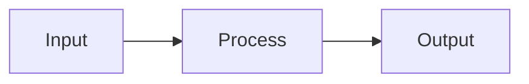

# Article title

> One sentence that defines the concept without jargon.

**Level:** beginner / intermediate / advanced  
**Time:** N minutes  
**Scope:** what this article covers. It does not cover: what it deliberately omits.

## The mental model

Start with a concrete analogy or scenario. Explain what it maps to. Then state where the analogy breaks.

## How it works

Introduce the mechanism. Use one Mermaid diagram.

Explain each step. Define acronyms on first use.

## A worked example

Use a small number, a code snippet, or a trace. Show the calculation or the sequence, not just the conclusion.

## Trade-offs

| Decision | Buys you | Costs you |
|---|---|---|
| Option A | | |
| Option B | | |

## Failure modes

| Failure | Symptom | Mitigation |
|---|---|---|
| | | |

## Check your understanding

1. A question that requires applying the model.
2. A question about a trade-off.
3. A question about a failure mode.

## Primary sources

- Author, [Title](https://example.com), year.
- Official documentation, [Page](https://example.com).
