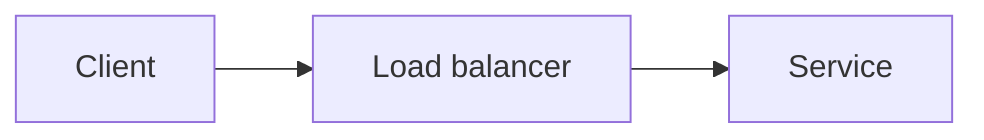

# Contributing to The Tech Atlas

Thanks for helping make technology easier to understand. We care more about a correct, useful explanation than a long one.

## The 60-second contribution

1. Open the article you want to improve.
2. Use GitHub's **Edit** button.
3. Fix one claim, add one source, or clarify one paragraph.
4. Open a pull request with the reason for the change.

For a new article, open an issue first using the article proposal template. We do not accept 3,000-word dumps without an outline and sources.

## What belongs here

Original, source-backed explanations of how modern technology works. Every article must teach a mental model, show a mechanism, name the trade-offs, and link primary sources.

**Not accepted:**

- SEO rewrites or copied blog posts.
- AI-generated articles submitted without fact-checking and editing.
- Product tutorials disguised as explanations.
- Listicles without a conceptual through-line.
- Diagrams copied without a compatible licence.

## Article contract

Every article follows this structure:

```md
# Title

> One-sentence definition.

**Level:** beginner / intermediate / advanced
**Time:** approximate reading time
**Scope:** what this covers and what it does not

## The mental model
## How it works
## A worked example
## Trade-offs
## Failure modes
## Check your understanding
## Primary sources
```

Use [ARTICLE_TEMPLATE.md](ARTICLE_TEMPLATE.md). Keep the first screen useful: definition, scope, and the core idea.

## Writing rules

- **Define before you abbreviate.** Expand an acronym on first use.
- **Use concrete numbers** when they clarify a trade-off, and state the assumption.
- **Say where the analogy breaks.** Analogies are scaffolding, not proof.
- **Prefer the active voice.** “The router forwards the packet,” not “the packet is forwarded.”
- **Separate fact from opinion.** Label design preferences.
- **No hype.** “Fast” needs a baseline; “secure” needs a threat model.
- **No invisible assumptions.** If an example uses a specific database or cloud, say so.
- **Cite primary sources.** Specifications, papers, and first-party documentation beat summaries.
- **Keep diagrams original.** Mermaid or your own SVG; include a caption.

## Fact-checking

- Verify every numeric claim and version-specific statement against the linked source.
- Re-check the source date. A 2019 benchmark may still be useful, but label it.
- When sources disagree, explain the disagreement instead of picking the more exciting one.
- Remove claims you cannot verify. “Unknown” is an acceptable answer.

## Diagrams

Use Mermaid when the diagram is structural:



Use a table when the relationship is comparative. Do not use a diagram to decorate a paragraph that already says the same thing.

## Review checklist

- [ ] The definition is accurate and one sentence.
- [ ] The scope states what is omitted.
- [ ] The diagram renders and has a caption.
- [ ] Trade-offs include costs, not just benefits.
- [ ] Failure modes are concrete and observable.
- [ ] The three questions require reasoning.
- [ ] Sources are primary and reachable.
- [ ] No copied text or unlicensed diagram.

## Local checks

```bash
# Markdown links
lychee --config lychee.toml --no-progress './**/*.md'

# Optional: preview Mermaid with the CLI
npx -y @mermaid-js/mermaid-cli -i path/to/diagram.mmd -o /tmp/diagram.svg
```

Pull requests run the link checker. A link that blocks automated clients may be exempted in `lychee.toml` with a reason.

## Licence

By contributing, you agree that original text and diagrams are licensed under the repository's MIT licence. You retain attribution, but you grant the project permission to publish and adapt the work.
