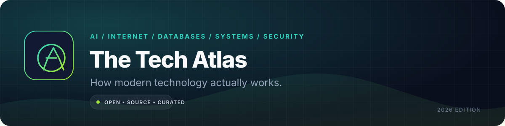

  

<h1 align="center">The Tech Atlas</h1>

  <strong>An open encyclopedia of modern technology.</strong> 
  Clear mental models, real diagrams, honest trade-offs, and primary sources — from DNS to diffusion models.

  <a href="#start-here">Start here</a> •
  <a href="#the-atlas">All articles</a> •
  <a href="#how-an-article-is-built">Method</a> •
  <a href="#learning-paths">Learning paths</a> •
  <a href="CONTRIBUTING.md">Contribute</a>

  
  
  
  

> **Most technology explanations fail at the same point:** they define a term without giving you a model you can reason with. The Tech Atlas is an attempt to fix that. Every article explains the problem, the mechanism, the trade-off, and the failure mode — then points you to the primary source.

## What this is

- **An encyclopedia, not a link dump.** Each article is written to be read on its own.
- **Beginner-accessible, technically honest.** We start with a mental model, then go deep enough to be useful.
- **Source-backed.** Claims link to specifications, papers, and first-party documentation.
- **Living.** Articles carry a review date and a scope note. Corrections are welcome.

## What this is not

- A replacement for a textbook, official docs, or hands-on practice.
- A collection of interview answers to memorise.
- A hype feed. If a topic is unsettled, the article says so.
- A place for copied articles. Every page is original synthesis with attributed sources.

## Start here

New to the atlas? Pick the question that sounds most like you:

| Question | Read this | Then |
|---|---|---|
| “What actually happens when I open a website?” | [How the internet works](./internet/how-the-internet-works.md) | [DNS](./internet/dns-explained.md) → [HTTP and HTTPS](./internet/http-vs-https.md) |
| “Why is my API slow?” | [Caching](./system-design/caching.md) | [Load balancing](./system-design/load-balancing.md) → [Database indexing](./databases/database-indexing.md) |
| “How does an LLM generate text?” | [LLM architecture](./artificial-intelligence/llm-architecture.md) | [Embeddings and vector search](./artificial-intelligence/embeddings-and-vector-search.md) → [RAG](./artificial-intelligence/rag-explained.md) |
| “Why do databases lose data?” | [Transactions](./databases/database-transactions.md) | [Replication](./databases/replication.md) → [Message queues](./system-design/message-queues.md) |
| “How do I keep a service from being overwhelmed?” | [Rate limiting](./system-design/rate-limiting.md) | [Queues](./system-design/message-queues.md) → [Load balancing](./system-design/load-balancing.md) |
| “What is the difference between authn and authz?” | [Authentication vs authorization](./security/authentication-vs-authorization.md) | [Encryption](./security/encryption.md) |

## The atlas

### Artificial intelligence

| Article | The question it answers | Level | Time |
|---|---|---|---|
| [How LLMs work](./artificial-intelligence/llm-architecture.md) | What is actually happening inside a transformer when it predicts the next token? | Beginner → intermediate | 12 min |
| [Embeddings and vector search](./artificial-intelligence/embeddings-and-vector-search.md) | How does a computer turn meaning into coordinates, and how do you search them? | Beginner | 10 min |
| [RAG explained](./artificial-intelligence/rag-explained.md) | How do you give a model private knowledge without retraining it? | Intermediate | 11 min |
| [AI agents](./artificial-intelligence/ai-agents.md) | When is a system an agent, and why do agents fail? | Intermediate | 10 min |
| [Model quantisation](./artificial-intelligence/model-quantization.md) | Why can a smaller, lower-precision model run on your laptop? | Intermediate | 9 min |

### The internet

| Article | The question it answers | Level | Time |
|---|---|---|---|
| [How the internet works](./internet/how-the-internet-works.md) | What are packets, routers, and autonomous systems actually doing? | Beginner | 11 min |
| [DNS explained](./internet/dns-explained.md) | How does a name become an IP address, and why does DNS take time to propagate? | Beginner | 9 min |
| [HTTP and HTTPS](./internet/http-vs-https.md) | What is in a request, and what does TLS actually protect? | Beginner | 12 min |
| [TCP vs UDP](./internet/tcp-vs-udp.md) | Why do some applications need reliability and others need low latency? | Beginner | 8 min |
| [CDNs explained](./internet/cdn-explained.md) | How does content get physically closer to users, and when does a CDN hurt? | Beginner | 8 min |

### Programming

| Article | The question it answers | Level | Time |
|---|---|---|---|
| [Compilers vs interpreters](./programming/compilers-vs-interpreters.md) | Where does source code become behaviour, and why does the distinction blur? | Beginner | 9 min |
| [Memory management](./programming/memory-management.md) | Stack, heap, GC, ownership — who frees what, and when? | Beginner → intermediate | 11 min |
| [Concurrency vs parallelism](./programming/concurrency.md) | Why can a single-core program be concurrent, and why do race conditions happen? | Intermediate | 10 min |
| [Type systems](./programming/type-systems.md) | What do static, dynamic, strong, and weak types actually mean? | Beginner | 9 min |

### Databases

| Article | The question it answers | Level | Time |
|---|---|---|---|
| [SQL vs NoSQL](./databases/sql-vs-nosql.md) | How should you choose a data model without cargo-culting either camp? | Beginner | 10 min |
| [Database indexing](./databases/database-indexing.md) | Why is an index fast, and why can it make writes slower? | Beginner → intermediate | 11 min |
| [Database transactions](./databases/database-transactions.md) | What does ACID actually guarantee, and what does it not? | Intermediate | 10 min |
| [Replication](./databases/replication.md) | How do copies stay in sync, and why is replication lag dangerous? | Intermediate | 11 min |

### System design

| Article | The question it answers | Level | Time |
|---|---|---|---|
| [Load balancing](./system-design/load-balancing.md) | How does traffic reach many servers without a single point of failure? | Beginner | 9 min |
| [Caching](./system-design/caching.md) | Why is a cache fast, and how does it become wrong? | Beginner → intermediate | 11 min |
| [Message queues](./system-design/message-queues.md) | When should work happen later, and what happens when it fails? | Intermediate | 10 min |
| [Rate limiting](./system-design/rate-limiting.md) | How do you protect a system without punishing legitimate users? | Beginner → intermediate | 10 min |

### Security

| Article | The question it answers | Level | Time |
|---|---|---|---|
| [Authentication vs authorization](./security/authentication-vs-authorization.md) | Who are you, what are you allowed to do, and where do tokens fit? | Beginner | 9 min |
| [Encryption](./security/encryption.md) | What do symmetric, asymmetric, and hashing actually protect? | Beginner → intermediate | 11 min |

### Cloud and DevOps

| Article | The question it answers | Level | Time |
|---|---|---|---|
| [Containers vs virtual machines](./cloud-devops/containers-vs-vms.md) | What is a container isolating, and what is it not isolating? | Beginner | 9 min |
| [CI/CD](./cloud-devops/ci-cd.md) | How does code become a safe, repeatable deployment? | Beginner | 10 min |

### Computer science

| Article | The question it answers | Level | Time |
|---|---|---|---|
| [Big-O notation](./computer-science/big-o.md) | How do we compare algorithms without benchmarking every machine? | Beginner | 10 min |
| [Data structures](./computer-science/data-structures.md) | Which structure fits which access pattern, and why? | Beginner | 12 min |

## Learning paths

### Web developer

1. [How the internet works](./internet/how-the-internet-works.md)
2. [DNS](./internet/dns-explained.md)
3. [HTTP and HTTPS](./internet/http-vs-https.md)
4. [CDNs](./internet/cdn-explained.md)
5. [Caching](./system-design/caching.md)
6. [Authentication vs authorization](./security/authentication-vs-authorization.md)
7. [Encryption](./security/encryption.md)

### Backend engineer

1. [TCP vs UDP](./internet/tcp-vs-udp.md)
2. [Load balancing](./system-design/load-balancing.md)
3. [Database indexing](./databases/database-indexing.md)
4. [Transactions](./databases/database-transactions.md)
5. [Replication](./databases/replication.md)
6. [Message queues](./system-design/message-queues.md)
7. [Rate limiting](./system-design/rate-limiting.md)
8. [Containers vs VMs](./cloud-devops/containers-vs-vms.md)

### AI engineer

1. [How LLMs work](./artificial-intelligence/llm-architecture.md)
2. [Embeddings and vector search](./artificial-intelligence/embeddings-and-vector-search.md)
3. [RAG](./artificial-intelligence/rag-explained.md)
4. [AI agents](./artificial-intelligence/ai-agents.md)
5. [Model quantisation](./artificial-intelligence/model-quantization.md)
6. [Caching](./system-design/caching.md)
7. [Rate limiting](./system-design/rate-limiting.md)

### Interview preparation

1. [Big-O](./computer-science/big-o.md)
2. [Data structures](./computer-science/data-structures.md)
3. [Caching](./system-design/caching.md)
4. [Load balancing](./system-design/load-balancing.md)
5. [Database indexing](./databases/database-indexing.md)
6. [Replication](./databases/replication.md)
7. [Message queues](./system-design/message-queues.md)
8. [Rate limiting](./system-design/rate-limiting.md)

### Curious technologist

1. [How the internet works](./internet/how-the-internet-works.md)
2. [DNS](./internet/dns-explained.md)
3. [Compilers vs interpreters](./programming/compilers-vs-interpreters.md)
4. [Memory management](./programming/memory-management.md)
5. [Encryption](./security/encryption.md)
6. [How LLMs work](./artificial-intelligence/llm-architecture.md)

## How an article is built

Every article follows the same contract:

1. **One-sentence definition.** No throat-clearing.
2. **The mental model.** A concrete analogy, then where the analogy breaks.
3. **The mechanism.** A diagram and the actual moving parts.
4. **A worked example.** Numbers, code, or a trace you can follow.
5. **Trade-offs.** A table of costs, not a list of benefits.
6. **Failure modes.** What breaks, and how you would notice.
7. **Check your understanding.** Three questions that require reasoning, not recall.
8. **Primary sources.** Specifications, papers, and official docs.

**Scope note:** each article states what it covers and what it deliberately omits. A page about DNS is not a page about BGP, even though they meet.

## Reading lists

- [Books that are worth the shelf space](./resources/books.md)
- [Papers that changed how systems are built](./resources/papers.md)

## Contributing

Corrections, diagrams, and new articles are welcome. Start with [CONTRIBUTING.md](CONTRIBUTING.md), then open an issue using the article proposal template. We prefer a careful 600-word explanation over a 3,000-word brain dump.

**Editorial stance:** no AI-generated article dumps, no undisclosed sponsorship, no copied diagrams. If you use a diagram, it must be original or correctly licensed.

## License

Original articles and diagrams are released under the [MIT License](LICENSE). Quoted material, linked papers, and trademarks remain the property of their owners. Attribution is appreciated but not required by the licence; it is required by good manners.

---

**Last reviewed: 2026-11-03.** Prices, metrics, licences, and availability change; verify against the linked upstream source before relying on them.
