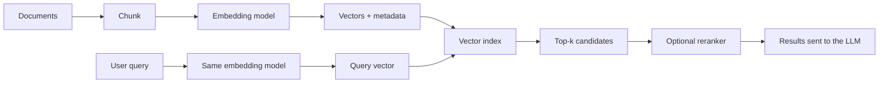

# Embeddings and vector search

> An embedding is a numeric vector that places semantically similar items near each other; vector search finds those neighbours without comparing a query to every document one by one.

**Level:** beginner  
**Time:** 10 minutes  
**Scope:** text embeddings and approximate nearest-neighbour search. The same ideas apply to images and audio, but the model and evaluation differ.

## The mental model

A library has no alphabetical index, only a giant map of meaning. Books about sourdough, yeast, and bread ovens sit in the same neighbourhood. A query, “how do I make bread rise?”, is placed on the same map. The nearest books are the retrieval candidates.

The map is not literal. Each dimension is an abstract feature learned from data. You cannot reliably read a single dimension and say “this means ‘food’”. You can only compare positions.

Where the analogy breaks: **near** does not always mean **relevant**. Two passages can be close because they share jargon, sentiment, or style while answering different questions. That is why retrieval needs evaluation and often reranking.

## The pipeline



The document and query must use the **same model and preprocessing**. Mixing embedding models is like comparing coordinates from two different maps.

## Similarity

The most common measure is **cosine similarity**: the cosine of the angle between two vectors. It ignores magnitude, so a short and a long passage can still be close if they point in the same direction.

For vectors that are already normalised to unit length, cosine similarity and dot product produce the same ranking. Euclidean distance is also used; it cares about magnitude, so normalisation matters.

```text
cosine(a, b) = (a · b) / (||a|| × ||b||)
```

Text embeddings are often trained with a contrastive objective: pull a query toward a relevant passage and push it away from unrelated passages.

## Approximate nearest neighbour (ANN)

Comparing 10 million vectors to one query is too slow for an interactive request. ANN indexes trade a small amount of recall for a large speedup.

| Index | Idea | Strength | Weakness |
|---|---|---|---|
| **HNSW** | Build a layered proximity graph; search the graph greedily | High recall and low latency | High memory; expensive deletes and rebuilds |
| **IVF** | Cluster vectors, then search only nearby clusters | Lower memory; fast on large corpora | Can miss a relevant vector in an unprobed cluster |
| **PQ** | Compress each vector into a short code | Huge memory savings | Lossy; recall drops without tuning |
| **DiskANN** | Graph index on SSD | Large datasets at lower RAM | I/O latency and operational complexity |
| **Flat / exact** | Compare every vector | Perfect recall | Only practical for small datasets |

Tuning parameters such as `M`, `ef_construction`, and `nprobe` changes the recall/latency/memory triangle. Benchmark on **your** corpus, not a vendor's demo.

## Chunking is part of the model

A document-level embedding blurs many ideas into one vector. Chunking keeps passages focused.

| Strategy | Best for | Problem |
|---|---|---|
| Fixed token window | Baseline, homogeneous text | Splits sentences and ideas |
| Sentence/paragraph | Prose, docs | Uneven lengths |
| Heading-aware | Technical docs, policies | Needs structure-aware parsing |
| Semantic | Long articles with topic shifts | Slower and less predictable |
| Parent-child | Precise retrieval with broader context | More storage and lookup complexity |

Store metadata with each vector: source, title, section, timestamp, access level, and a stable chunk ID. Metadata enables filtering and citations; it also prevents a tenant from retrieving another tenant's data.

## Hybrid search

Dense embeddings capture meaning. Lexical search (BM25) captures exact names, error codes, and rare identifiers. Hybrid search combines both, often with reciprocal rank fusion.

```text
score = α × dense_score + (1 - α) × lexical_score
```

Then a **cross-encoder reranker** can score the top 20–100 candidates against the query with much more compute than the embedding model. This two-stage pattern is common: cheap recall first, expensive precision second.

## Evaluation

You cannot tune what you cannot measure. Build a small labelled set:

- **Recall@k:** was the relevant passage in the top k?
- **MRR / nDCG:** how highly was it ranked?
- **Answer correctness:** did the final answer use the passage correctly?
- **Latency and cost:** p50/p95 and cost per successful query.

A retrieval system that returns the right document at rank 40 is not useful if the LLM only sees the top 5. Measure the whole pipeline.

## Failure modes

| Failure | Cause | Fix |
|---|---|---|
| Semantically close, factually wrong | Embedding model not trained for the domain | Domain evaluation, reranking, hybrid search |
| Exact identifier missed | Dense vectors blur rare tokens | Add BM25 or keyword filters |
| Stale answer | Index not rebuilt after source change | Versioned ingestion and invalidation |
| Tenant data leak | Missing metadata filter | Enforce filters at the query layer, not the prompt |
| Chunk boundary loses context | Fixed-size splitting | Overlap, heading-aware, parent-child retrieval |
| Recall collapse after compression | Aggressive PQ or low `ef_search` | Tune against a labelled set |

## Check your understanding

1. Why must the document and query use the same embedding model?
2. Your top-5 results look relevant but the answer is wrong. What are two different failure points to investigate?
3. When would exact flat search be a better engineering choice than HNSW?

## Primary sources

- Reimers and Gurevych, [Sentence-BERT](https://arxiv.org/abs/1908.10084).
- Malkov and Yashunin, [HNSW](https://arxiv.org/abs/1603.09320).
- Muennighoff et al., [MTEB: Massive Text Embedding Benchmark](https://arxiv.org/abs/2210.07316).
- [pgvector](https://github.com/pgvector/pgvector) documentation for Postgres vector indexes.
- [FAISS](https://github.com/facebookresearch/faiss) documentation for ANN index families.

> **Next:** [RAG explained](./rag-explained.md) puts retrieval behind a language model.

---

**Last reviewed: 2026-11-03.** Corrections welcome; open an issue with a primary source.
