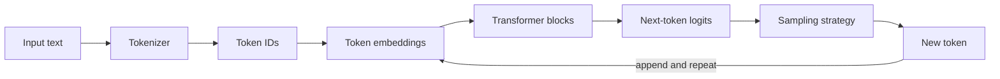

# How large language models work

> A large language model (LLM) is a neural network trained to predict the next token in a sequence; conversation, code generation, and reasoning are behaviours that emerge from doing that prediction extremely well at scale.

**Level:** beginner → intermediate  
**Time:** 12 minutes  
**Scope:** decoder-only transformer LLMs used for chat and code. It does not cover training infrastructure, multimodal encoders, or reinforcement-learning details.

## The mental model

Imagine a very expensive autocomplete. You give it a sequence of tokens; it assigns a probability to every possible next token; you pick one; then you append it and repeat.

That sounds too simple to produce an essay. The important part is that the model has learned statistical structure from a very large corpus: grammar, facts, code patterns, styles, and some reasoning shortcuts. It is not looking up a stored answer. It is constructing a continuation that fits the context.

Where the analogy breaks: autocomplete usually sees a short prefix and predicts a word. An LLM sees a long context, uses attention to relate distant tokens, and can produce a long sequence where each new token changes the probabilities of the next.

## The pipeline



### 1. Tokenisation

The model does not read characters or words. A tokenizer splits text into subword units. Common words may be one token; rare words are split into pieces. Code, emoji, and non-Latin scripts can tokenise inefficiently.

This matters because:

- **Cost** is usually per token, not per character.
- **Context limits** are measured in tokens.
- **Arithmetic and spelling** can fail when the model never sees the individual characters.

### 2. Embeddings

Each token ID indexes a learned vector. Position information is added or injected so the model knows order. At this point, a token is a point in a high-dimensional space, not a dictionary definition.

### 3. Transformer blocks

A decoder-only transformer stacks blocks. A typical block has:

1. **Self-attention.** Each token produces a query, key, and value. The query compares against keys to decide which earlier tokens matter, then mixes their values.
2. **Feed-forward network.** A per-token MLP transforms the representation.
3. **Residual connections and normalisation.** These keep gradients stable and preserve information across layers.

The attention pattern is causal: token 10 may attend to tokens 1–10, never token 11. That is what makes next-token prediction possible.

```text
For each token:
  Q = xWq, K = xWk, V = xWv
  scores = QK^T / sqrt(d)
  scores = mask future positions with -infinity
  weights = softmax(scores)
  output = weights V
```

In production, the keys and values for previous tokens are cached. This **KV cache** avoids recomputing the whole prefix on every generated token, but it consumes memory that grows with context length and batch size.

### 4. Logits and sampling

The final layer produces a score for every token in the vocabulary. A softmax turns those scores into probabilities. The model does not have to pick the highest-probability token.

| Strategy | What it does | Effect |
|---|---|---|
| Greedy | Always pick the top token | Deterministic, often repetitive |
| Temperature | Scale logits before softmax | Lower = focused; higher = diverse |
| Top-k | Sample from the k most likely tokens | Truncates the long tail |
| Top-p / nucleus | Sample from the smallest set whose probability exceeds p | Adaptive truncation |
| Repetition penalty | Down-weight recently used tokens | Reduces loops, can hurt exact repetition |

## Training vs inference

**Training** adjusts billions of parameters to reduce next-token prediction loss. It is a sequence of forward passes, loss calculation, backpropagation, and gradient updates across enormous batches.

**Inference** uses fixed parameters to generate tokens. It is cheaper per token than training but still expensive because every generated token requires a forward pass through the network.

**Fine-tuning** continues training on a narrower dataset. It changes behaviour and style more reliably than facts. **Retrieval** adds facts at inference time without changing weights.

## What the model does not do

- It does not have a reliable internal database of current facts.
- It does not remember a previous conversation unless the context is supplied again.
- It does not execute code unless a tool does so.
- It does not guarantee that a confident sentence is true.
- It does not inherently know when to stop; stop sequences and post-processing enforce that.

## Trade-offs

| Decision | Buys you | Costs you |
|---|---|---|
| Bigger model | Better reasoning and world knowledge | More VRAM, latency, and cost |
| Longer context | More material in one request | Quadratic attention cost and KV-cache memory |
| Higher temperature | Diversity | Less consistency and more hallucination |
| Quantisation | Smaller memory footprint | Some quality loss, especially at aggressive bit widths |
| Mixture of experts | More parameters at lower active compute | Routing complexity and memory for all experts |

## Failure modes and how to notice them

| Failure | Symptom | Mitigation |
|---|---|---|
| Hallucination | Fluent, specific, wrong citation | Retrieval, citations, verification, evals |
| Context overflow | Forgets early instructions | Chunking, summarisation, explicit state |
| Tokenisation edge case | Miscounts letters or fails at arithmetic | Tools, character-level checks |
| Prompt injection | Follows instructions inside retrieved text | Treat retrieved content as data, isolate tools |
| Degeneration | Repetition or empty output | Sampling settings, stop conditions, retries |
| KV-cache exhaustion | Out-of-memory at long context | Smaller batch, paged attention, shorter context |

## Check your understanding

1. Why does a decoder-only model need a causal mask during training?
2. A 32k-token context is full. What are three different ways to continue the conversation, and what does each sacrifice?
3. Why can a model write plausible code but still fail to sort a list correctly without running it?

## Primary sources

- Vaswani et al., [Attention Is All You Need](https://arxiv.org/abs/1706.03762) (2017).
- Brown et al., [Language Models are Few-Shot Learners](https://arxiv.org/abs/2005.14165) (2020).
- Hugging Face, [LLM course](https://huggingface.co/learn/llm-course).
- vLLM, [PagedAttention paper](https://arxiv.org/abs/2309.06180) for KV-cache management.
- OpenAI, [Understanding and counting tokens](https://help.openai.com/en/articles/4936856-understanding-and-counting-tokens).

> **Next:** [Embeddings and vector search](./embeddings-and-vector-search.md) explains how text becomes coordinates that can be searched.

---

**Last reviewed: 2026-11-03.** Corrections welcome; open an issue with a primary source.
