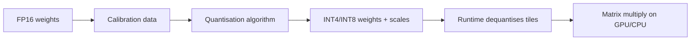

# Model quantisation

> Quantisation stores a model's numbers with fewer bits, trading a small amount of numerical precision for much lower memory use and often faster inference.

**Level:** intermediate  
**Time:** 9 minutes  
**Scope:** inference-time quantisation for LLMs. It does not cover quantisation-aware training or hardware-specific kernel internals.

## The mental model

A photograph saved as a 4K PNG is huge. The same image as a high-quality JPEG is much smaller and looks nearly identical — until you zoom into a gradient or a sharp edge. Quantisation does the same thing to neural-network weights: fewer bits per number, noticeable degradation only when the compression is aggressive or the task is sensitive.

Where the analogy breaks: model quality does not degrade uniformly. A 4-bit model can be excellent at chat and worse at exact arithmetic, long-context recall, or rare-language generation.

## What is stored

A model has **weights** (parameters) and **activations** (intermediate values). You can quantise either.

| Format | Bits per value | Approx. bytes per parameter | 7B model weights |
|---|---:|---:|---:|
| FP32 | 32 | 4.0 | ~28 GB |
| FP16 / BF16 | 16 | 2.0 | ~14 GB |
| INT8 | 8 | 1.0 | ~7 GB |
| INT4 | 4 | 0.5 | ~3.5 GB |

These are weight-only estimates. Real memory also includes the KV cache, activations, CUDA context, and framework overhead. A “4-bit 7B” model often needs 5–6 GB before a long context.



## Common approaches

| Method | Idea | Strength | Trade-off |
|---|---|---|---|
| **GPTQ** | Post-training, layer-wise weight quantisation with error compensation | Good 4-bit quality; wide support | Calibration-dependent; can be slow to produce |
| **AWQ** | Protect the most salient weight channels | Strong quality at low bits | Needs calibration and compatible kernels |
| **GGUF k-quants** | Block-wise formats used by llama.cpp | CPU/Apple Silicon friendly; many sizes | Quality varies by quant level |
| **bitsandbytes** | On-the-fly 8-bit/4-bit loading | Easy integration with Transformers | Runtime overhead; not always the fastest |
| **SmoothQuant** | Shift activation outliers into weights | Better INT8 activation quantisation | More complex integration |
| **QAT** | Train with simulated quantisation | Best low-bit quality | Expensive; requires training pipeline |

**Calibration** is a small dataset used to estimate scales and identify important channels. A calibration set that does not resemble your traffic can produce worse results on your domain.

## How to choose a level

| Level | Typical use | Watch |
|---|---|---|
| FP16/BF16 | Quality baseline; training; short-context serving | Highest memory |
| INT8 | General inference with modest quality loss | Kernel and hardware support |
| 4-bit (Q4/Q5) | Local chat, prototypes, cost-sensitive serving | Test reasoning and long context |
| 3-bit or lower | Extreme memory limits | Expect visible degradation; use task evals |

There is no universal “4-bit is fine.” Evaluate on the tasks you care about. A coding model may tolerate 4-bit for autocomplete but fail on a multi-file refactor.

## Memory math

A rough planning formula:

```text
weights_gb ≈ parameters_billions × bits_per_weight / 8

total_gb ≈ weights_gb
         + kv_cache_gb
         + activation_overhead
         + runtime_overhead
```

For a 7B model at 4 bits: `7 × 4 / 8 = 3.5 GB` for weights. Add 1–3 GB for a modest context and runtime. For a 70B model at 4 bits: `70 × 4 / 8 = 35 GB`, plus KV cache and overhead; a 48 GB GPU is tight, not comfortable.

KV-cache size grows with `layers × heads × head_dim × sequence_length × batch × bytes_per_value`. Long context and high concurrency can dominate memory even after quantising weights.

## What quantisation does not fix

- **Context length.** The KV cache still grows with tokens.
- **Throughput.** A smaller model may be faster, but memory bandwidth and kernels matter.
- **Quality.** It usually reduces it slightly; aggressive formats can reduce it a lot.
- **Training.** Quantised inference is not a training strategy.

## Failure modes

| Symptom | Likely cause | Fix |
|---|---|---|
| Garbage output after loading | Wrong format or missing chat template | Match the runtime, tokenizer, and template |
| Good short answers, bad long context | KV cache or rope scaling misconfigured | Check context settings and memory |
| Math and code regress | Low-bit quantisation hurts precision | Try Q5/Q6 or a larger model |
| Slow despite smaller weights | CPU offload or dequantisation overhead | Use GPU-native kernels; measure tokens/s |
| OOM at high concurrency | KV cache, not weights | Limit batch/context; use paged attention |

## Check your understanding

1. Why does a “4-bit 7B” model not fit in exactly 3.5 GB of GPU memory?
2. You need long-context document QA on one 24 GB GPU. What would you measure before choosing a quantisation level?
3. Why can a quantised model be faster in tokens/second but slower in time-to-first-token?

## Primary sources

- Frantar et al., [GPTQ](https://arxiv.org/abs/2210.17323).
- Lin et al., [AWQ](https://arxiv.org/abs/2306.00978).
- Dettmers et al., [LLM.int8()](https://arxiv.org/abs/2208.07339).
- [llama.cpp quantisation documentation](https://github.com/ggml-org/llama.cpp/blob/master/tools/quantize/README.md).
- Hugging Face, [Quantisation guide](https://huggingface.co/docs/transformers/main/en/quantization/overview).

> **Next:** [How the internet works](../internet/how-the-internet-works.md) moves from models to packets.

---

**Last reviewed: 2026-11-03.** Corrections welcome; open an issue with a primary source.
