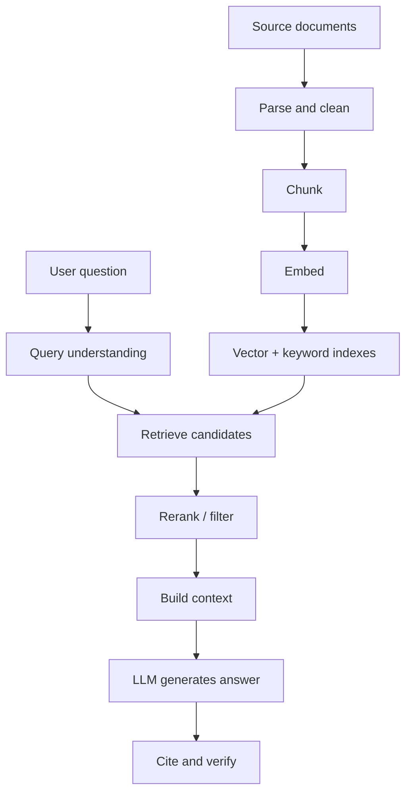

# RAG explained

> Retrieval-augmented generation (RAG) fetches relevant material at query time and places it in the model's context, so answers can use private or current knowledge without changing the model's weights.

**Level:** intermediate  
**Time:** 11 minutes  
**Scope:** text RAG for question answering and assistants. It does not cover multimodal RAG, graph RAG, or training a retriever from scratch.

## The mental model

An open-book exam. The model is the student; the retriever is the index; the context window is the page you are allowed to read. The student still has to understand the page, notice when it is irrelevant, and avoid inventing a citation.

RAG is not a database lookup with a language model bolted on. It is a **pipeline with several independent failure points**. A perfect generator cannot save a retriever that returns the wrong page.

## The pipeline

### 1. Ingestion

Parse the source before you chunk it. HTML, PDFs, spreadsheets, and scanned images have different structure. Preserve headings, tables, page numbers, and access metadata.

Clean obvious noise: navigation, repeated headers, cookies banners, boilerplate. Do not strip so aggressively that you remove the section that gives a chunk its meaning.

### 2. Chunking

A chunk should be small enough to be specific and large enough to be self-contained. For docs, heading-aware chunks with a small overlap usually beat fixed windows. For legal or policy text, preserve section numbers and definitions.

**Parent-child retrieval** is a useful pattern: embed small child chunks for precise matching, but send the larger parent section to the model for context.

### 3. Indexing

Use dense embeddings for meaning and lexical search for exact terms. Hybrid retrieval is especially valuable for code, product names, IDs, and acronyms. Metadata filters enforce permissions and narrow the search space before vector comparison.

### 4. Retrieval

Retrieve more candidates than you will send to the model, then rerank. A cross-encoder can score each candidate against the query with more compute. Filter by tenant, recency, document status, and access rights.

### 5. Context construction

Order matters. Put the most relevant evidence near the instruction and the question. Label sources clearly. Include only what the model needs; a giant context increases cost and makes it easier to miss the relevant sentence.

### 6. Generation

Ask for a grounded answer with citations. If the evidence is insufficient, the correct answer is “I don't know from the provided sources.” That instruction must be explicit.

### 7. Verification

Check that every citation exists and actually supports the sentence. A model can cite a real document for a claim the document never makes. Automated citation checks catch some of this; human review catches the rest.

## RAG vs fine-tuning vs long context

| Approach | Best for | Does not solve | Cost profile |
|---|---|---|---|
| **RAG** | Private, changing, citable knowledge | Reasoning gaps, style, tool use | Retrieval + tokens per query |
| **Fine-tuning** | Format, tone, classification, domain behaviour | Fresh facts unless retrained | Training + hosting |
| **Long context** | A few large documents in one request | A corpus too large to fit; precise retrieval | Quadratic attention and high token cost |
| **Tools/APIs** | Live data and actions | Unstructured knowledge retrieval | Per-call latency and integration work |

These are complementary. A strong assistant may use a small fine-tuned model for routing, RAG for knowledge, and tools for actions.

## Failure modes

| Failure | What the user sees | Root cause | Fix |
|---|---|---|---|
| Retrieval miss | Confident wrong answer | Query and document vocabulary mismatch | Hybrid search, query rewriting, better embeddings |
| Context poisoning | Answer follows instructions in a document | Prompt injection in retrieved text | Treat sources as data; isolate tool permissions |
| Stale answer | Old policy quoted | Index not updated | Versioned ingestion and invalidation |
| Over-stuffing | Model ignores the key sentence | Too many low-value chunks | Rerank, deduplicate, shrink context |
| Citation confabulation | Real link, wrong claim | No entailment check | Citation verification and evals |
| Chunk fragmentation | Definition separated from example | Naive fixed chunking | Heading-aware or parent-child chunks |
| Permission leak | User sees another tenant's data | Filters applied after retrieval | Enforce ACL at query time and in the index |

## A minimal evaluation set

Create 50–200 real questions with:

- the expected answer,
- the gold passage(s),
- whether the answer is answerable from the corpus,
- the required citation.

Track retrieval recall, answer correctness, citation correctness, refusal accuracy, latency, and cost. A RAG system that answers 90% of questions but cites the wrong source 20% of the time is not production-ready.

## Check your understanding

1. A user asks about a policy that changed last week. Which part of the pipeline must change, and which part can stay the same?
2. Why can adding more retrieved chunks make an answer worse?
3. Your retriever finds the right document, but the model says it cannot answer. What are two likely causes?

## Primary sources

- Lewis et al., [Retrieval-Augmented Generation for Knowledge-Intensive NLP Tasks](https://arxiv.org/abs/2005.11401) (2020).
- Anthropic, [Introducing Contextual Retrieval](https://www.anthropic.com/news/contextual-retrieval) (2024).
- Gao et al., [Retrieval-Augmented Generation for Large Language Models: A Survey](https://arxiv.org/abs/2312.10997).
- [pgvector](https://github.com/pgvector/pgvector) and [OpenSearch](https://docs.opensearch.org/) documentation for hybrid-search building blocks.
- OWASP, [LLM Top 10](https://genai.owasp.org/llm-top-10/) for prompt-injection and data-leak risks.

> **Next:** [AI agents](./ai-agents.md) add tools, state, and a loop.

---

**Last reviewed: 2026-11-03.** Corrections welcome; open an issue with a primary source.
