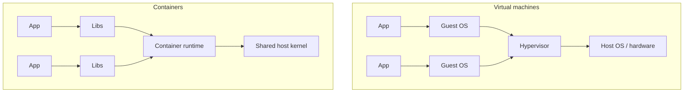

# Containers vs virtual machines

> A virtual machine runs a complete guest operating system on virtual hardware; a container packages an application and its dependencies but shares the host kernel.

**Level:** beginner  
**Time:** 9 minutes  
**Scope:** the isolation and packaging difference. It does not teach Kubernetes or container security in depth.

## The mental model

A **VM** is a house with its own foundation, plumbing, and electrical system. It is independent and heavy.

A **container** is an apartment in a shared building. It has its own locked door and furniture, but shares the building's plumbing and foundation. It is lighter and starts faster, but a problem in the shared kernel can affect every apartment.

Where the analogy breaks: containers use Linux namespaces and cgroups, not physical walls. A kernel exploit can cross the boundary.

## The architecture

### Virtual machines

- Virtualise CPU, memory, disk, and network.
- Each VM has its own kernel.
- Strong isolation boundary (assuming the hypervisor is sound).
- Slower boot and higher memory overhead.
- Good for different operating systems and hard multi-tenancy.

### Containers

- Package the app, runtime, libraries, and config.
- Share the host kernel.
- Use **namespaces** for visibility isolation (PID, network, mount, user).
- Use **cgroups** for resource limits.
- Start in milliseconds/seconds.
- Good for dense deployment and reproducible builds.

## What a container is not

- **Not a security boundary by default.** It is a process with restricted views and resources. Harden it: non-root user, read-only filesystem, seccomp, AppArmor/SELinux, dropped capabilities, no host mounts.
- **Not a virtual machine.** You cannot run a Windows container on a Linux kernel without a VM or compatibility layer.
- **Not an image.** The image is the packaged filesystem; the container is a running instance.
- **Not automatically stateless.** A container can write to a volume, but ephemeral storage disappears when it is replaced.

## The trade-off

| Concern | VM | Container |
|---|---|---|
| Startup | Seconds–minutes | Milliseconds–seconds |
| Density | Lower | Higher |
| Isolation | Stronger | Weaker without hardening |
| Guest OS | Full choice | Shares host kernel |
| Image size | GBs | MBs–GBs |
| Patching | Per guest OS | Base image + host kernel |
| Best for | Multi-tenant, mixed OS, strong isolation | Microservices, CI, reproducible apps |

## Security checklist

- Run as a non-root user.
- Use a minimal, pinned base image.
- Scan images for vulnerabilities.
- Sign images and verify provenance.
- Drop Linux capabilities.
- Set CPU/memory limits.
- Use a read-only root filesystem where possible.
- Do not mount the Docker socket into a container.
- Keep the host kernel patched.
- Separate tenants with VMs or a sandboxed runtime when the threat model demands it.

## Failure modes

| Symptom | Cause | Fix |
|---|---|---|
| Container exits immediately | Bad entrypoint or missing config | Check logs and run interactively |
| Works locally, fails in prod | Architecture or env mismatch | Multi-arch build, explicit env |
| Container OOM-killed | No memory limit or leak | Set limits, profile heap |
| Disk fills | Logs or writable layer growth | Log rotation, volumes |
| Host compromise | Privileged container or kernel exploit | Drop privileges, patch, isolate |
| Slow image pulls | Huge layers, poor caching | Multi-stage builds, layer ordering |

## Check your understanding

1. Why does a container start faster than a VM?
2. What does a container share with the host that a VM does not?
3. When would you choose a VM over a container for isolation?

## Primary sources

- Docker, [What is a container?](https://www.docker.com/resources/what-container/).
- Linux kernel, [Namespaces](https://docs.kernel.org/admin-guide/namespaces/index.html).
- Linux kernel, [Control groups](https://docs.kernel.org/admin-guide/cgroup-v2.html).
- NIST, [SP 800-190: Application Container Security](https://csrc.nist.gov/pubs/sp/800/190/final).
- Kubernetes, [Concepts](https://kubernetes.io/docs/concepts/).

> **Next:** [CI/CD](./ci-cd.md) turns these images into a repeatable delivery pipeline.

---

**Last reviewed: 2026-11-03.** Corrections welcome; open an issue with a primary source.
