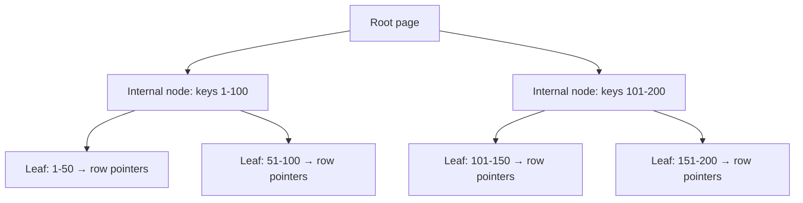

# Database indexing

> An index is a secondary data structure that lets the database find rows without scanning the whole table; it trades extra storage and write work for faster reads.

**Level:** beginner → intermediate  
**Time:** 11 minutes  
**Scope:** B-tree and hash indexes in relational databases, composite and covering indexes, and query-planner basics. It does not cover every index type or storage engine.

## The mental model

A book's index maps a term to page numbers. Without it, you read every page. With it, you jump to the relevant pages — but someone had to build and maintain the index when the book changed.

A database index is the same bargain. It stores a sorted or hashed representation of selected columns so the engine can locate rows quickly. Every insert, update, and delete must also update the index, which is why “index everything” is a bad strategy.

## B-tree: the default

Most relational indexes are B-trees (technically B+ trees). They keep keys sorted and support:

- equality (`WHERE email = ?`),
- ranges (`WHERE created_at > ?`),
- prefix matches (`WHERE name LIKE 'Ada%'`),
- ordering (`ORDER BY created_at`),
- min/max lookups.



The tree stays shallow: a few page reads can locate a row among millions. Leaf pages are linked, which makes range scans efficient.

## Hash indexes

A hash index maps a key to a bucket. It is excellent for equality but useless for ranges or sorting. Postgres hash indexes are crash-safe in modern versions, but B-tree remains the general-purpose default.

## Composite indexes

Column order matters. An index on `(tenant_id, created_at)` supports:

- `WHERE tenant_id = ?`
- `WHERE tenant_id = ? AND created_at > ?`
- `WHERE tenant_id = ? ORDER BY created_at`

It does **not** efficiently support `WHERE created_at > ?` alone. The leading column is the entry point. This is the “leftmost prefix” rule.

## Covering indexes

If the index contains every column a query needs, the database can answer from the index alone and avoid fetching the table row. This is an **index-only scan** (Postgres) or a covering index.

```sql
CREATE INDEX orders_tenant_created_covering
ON orders (tenant_id, created_at)
INCLUDE (total_cents, status);
```

The trade-off is a larger index and more write amplification. Cover the hot query, not every query.

## Selectivity and cardinality

**Cardinality** is the number of distinct values. **Selectivity** is how much a predicate narrows the result.

- A unique email is highly selective: a good index.
- A boolean `is_active` is low-cardinality: often a poor standalone index.
- A composite index can still use a low-cardinality leading column if all queries filter by tenant.

The planner estimates row counts and chooses between an index scan and a sequential scan. A small table may be faster to scan than to index.

## Reading the plan

```sql
EXPLAIN ANALYZE
SELECT id, total_cents
FROM orders
WHERE tenant_id = 't_123'
  AND created_at >= now() - interval '7 days'
ORDER BY created_at DESC
LIMIT 50;
```

Look for:

- **Seq Scan** on a large table: possibly a missing index.
- **Index Scan** vs **Bitmap Index Scan**: depends on selectivity and rows fetched.
- **Rows Removed by Filter**: the index is not selective enough.
- **Sort** with a large row count: an index may provide ordering.
- **Buffers**: shared vs read blocks, which reveals cache behaviour.

`EXPLAIN` shows the plan; `EXPLAIN ANALYZE` executes it. Be careful on production writes or expensive queries.

## The write cost

Every index adds:

- storage,
- memory pressure,
- insert/update/delete work,
- vacuum/maintenance overhead,
- migration time.

A table with ten indexes can turn a simple insert into eleven writes. Index for the queries you actually run, and remove unused indexes.

## Failure modes

| Symptom | Cause | Fix |
|---|---|---|
| Query is slow despite an index | Function on the column or type mismatch | Rewrite predicate or use an expression index |
| Index not used | Low selectivity or stale statistics | `ANALYZE`, review plan |
| Write latency increased | Too many indexes | Drop unused indexes |
| Bloat | Heavy updates and vacuum lag | Autovacuum tuning, monitoring |
| Wrong composite order | Leading column not in predicate | Reorder or add a matching index |
| Duplicate indexes | Overlapping definitions | Audit `pg_indexes` / catalog |

## Check your understanding

1. Why does an index on `(tenant_id, created_at)` not accelerate a query filtered only by `created_at`?
2. When would a sequential scan beat an index scan?
3. What does `Rows Removed by Filter` tell you about an index?

## Primary sources

- PostgreSQL, [Indexes](https://www.postgresql.org/docs/current/indexes.html).
- PostgreSQL, [Using EXPLAIN](https://www.postgresql.org/docs/current/using-explain.html).
- Winand, [Use The Index, Luke](https://use-the-index-luke.com/).
- SQLite, [Query planner](https://www.sqlite.org/optoverview.html).
- MySQL, [Optimization and indexes](https://dev.mysql.com/doc/refman/8.4/en/optimization-indexes.html).

> **Next:** [Database transactions](./database-transactions.md) explains how multiple changes stay atomic.

---

**Last reviewed: 2026-11-03.** Corrections welcome; open an issue with a primary source.
