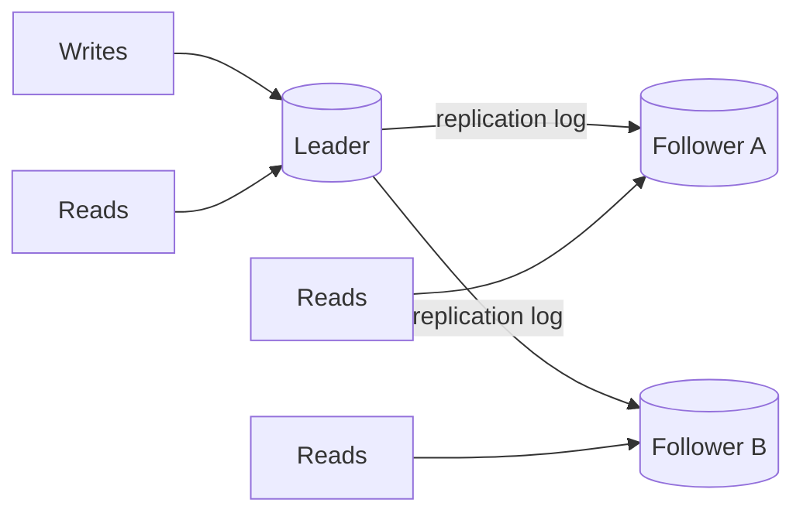

# Replication

> Replication keeps copies of data on multiple nodes; it improves availability and read capacity, but introduces lag, conflict, and failover problems.

**Level:** intermediate  
**Time:** 11 minutes  
**Scope:** leader-follower and multi-leader replication, quorum intuition, and failure modes. It does not cover consensus protocol proofs.

## The mental model

A teacher writes notes on the board. Students copy them into their notebooks. If the teacher's board is erased, a student can restore it. But students may be a few sentences behind, and two students may write different corrections.

Replication is copying. **Consistency** is the rule for how far behind a copy may be and what a reader is allowed to see. **Failover** is choosing a new teacher.

Where the analogy breaks: databases replicate logs, not prose, and a replica can be promoted automatically by a consensus system.

## Leader-follower



- All writes go to the leader.
- Followers replay the leader's log.
- Reads can be served by followers.
- If the leader fails, a follower is promoted.

**Synchronous** replication waits for at least one follower before acknowledging a write. It reduces data loss but increases latency and can block when a follower is slow. **Asynchronous** replication acknowledges immediately but can lose recent writes on failover.

## Replication lag

A follower is eventually consistent with the leader. If a user writes and immediately reads from a lagging follower, they may not see their own write.

Fixes:

- Read-your-writes routing: send a user's reads to the leader for a short window.
- Monotonic reads: pin a user to one replica.
- Causal consistency tokens: track the version the client has seen.
- Quorum reads/writes: require enough replicas to overlap.

Lag is not just a delay; it is a user-visible correctness issue.

## Multi-leader and leaderless

| Topology | Writes | Strength | Problem |
|---|---|---|---|
| Single leader | One node | Simple ordering, no write conflicts | Failover and write bottleneck |
| Multi-leader | Multiple nodes | Local writes across regions | Conflict resolution |
| Leaderless / quorum | Any replica | High availability | Read/write quorum tuning, conflicts |

Multi-leader replication is useful when regions must accept writes during a partition. The cost is conflict resolution: last-write-wins can silently lose data; CRDTs can merge some structures automatically; application-level reconciliation may be required.

## Quorums

With `N` replicas, a write quorum `W` and read quorum `R` overlap when `W + R > N`. That overlap increases the chance that a read sees the latest write.

```text
N = 3, W = 2, R = 2  → overlap of at least one replica
```

Quorums are not a proof of linearizability. Sloppy quorums, hinted handoff, and concurrent writes complicate the guarantee. Read the specific system's consistency model.

## Failover

Promotion is the dangerous part:

- **Split-brain:** two nodes believe they are leader.
- **Data loss:** an async follower is promoted before receiving the latest writes.
- **Stale routing:** clients still send writes to the old leader.
- **Fencing:** the old leader must be prevented from accepting writes.

Consensus systems (Raft, Paxos) use terms, quorums, and leases to reduce split-brain risk. Fencing tokens and a witness can help, but failover is never “free.”

## Logical vs physical replication

| Type | What is copied | Use |
|---|---|---|
| Physical | Block/page-level changes | Hot standby, exact clone |
| Logical | Row changes or SQL-level changes | Cross-version upgrades, selective replication |
| Trigger-based | Application-defined changes | Custom sync, audit |
| Change data capture | Database log stream | Event pipelines, analytics |

Logical replication is more flexible but can miss schema details unless managed carefully.

## Failure modes

| Failure | Symptom | Mitigation |
|---|---|---|
| Replica lag | Stale reads after a write | Read-your-writes, quorum, monitor lag |
| Replica divergence | Different data on nodes | Checksums, rebuild, logical validation |
| Split-brain | Two leaders accept writes | Fencing, quorum, consensus |
| Promotion data loss | Missing recent writes | Synchronous replication or accept RPO |
| Replication slot bloat | Disk fills on the leader | Monitor slots, cap retention |
| Cascading failure | One slow replica stalls commits | Timeouts, async fallback, load shedding |

## Check your understanding

1. Why can a user write successfully and then read stale data from a replica?
2. What does `W + R > N` actually guarantee, and what does it not guarantee?
3. Why is split-brain more dangerous than a simple node outage?

## Primary sources

- PostgreSQL, [Logical replication](https://www.postgresql.org/docs/current/logical-replication.html).
- PostgreSQL, [High availability and replication](https://www.postgresql.org/docs/current/high-availability.html).
- Kleppmann, [Designing Data-Intensive Applications](https://dataintensive.net/).
- Ongaro and Ousterhout, [Raft](https://raft.github.io/raft.pdf).
- Jepsen, [Consistency models](https://jepsen.io/consistency).

> **Next:** [Load balancing](../system-design/load-balancing.md) distributes traffic across these replicas and services.

---

**Last reviewed: 2026-11-03.** Corrections welcome; open an issue with a primary source.
