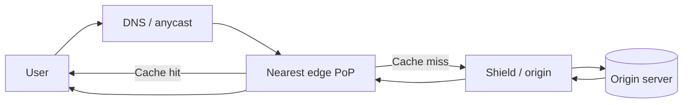

# CDNs explained

> A content delivery network is a geographically distributed layer of servers that caches and serves content close to users, reducing latency, origin load, and bandwidth cost.

**Level:** beginner  
**Time:** 8 minutes  
**Scope:** HTTP CDNs for static and dynamic content. It introduces anycast, caching, and purge behaviour but does not compare vendors.

## The mental model

A bakery chain. Instead of every customer travelling to the central kitchen, local shops keep the popular loaves fresh. The central kitchen still bakes custom orders. If a local shop has stale bread, the customer gets stale bread until it is replaced.

A CDN is the local shop. The **origin** is the central kitchen. The **TTL** decides how long a local copy is considered fresh. A **purge** tells the shops to throw it away.

Where the analogy breaks: CDN nodes are not independent shops with their own inventory decisions. They follow cache rules, request coalescing, and routing controlled by the provider.

## How a request reaches an edge

**Anycast** advertises the same IP address from many locations; routing usually sends the user to a nearby one. DNS-based routing maps users to a region instead. Many CDNs use both.

**TLS termination** often happens at the edge. The CDN holds a certificate for your hostname and opens a new connection to the origin. That is why certificate configuration and origin authentication matter.

## What gets cached

A cache key is the identity of a stored response. The URL is the default, but headers such as `Accept-Encoding`, `Accept-Language`, cookies, and query strings may be included.

| Content | Cacheable? | Typical policy |
|---|---|---|
| Hashed JS/CSS assets | Yes, for a long time | `max-age=31536000, immutable` |
| Images | Yes | Long TTL; versioned URLs |
| HTML shell | Often | Short TTL or revalidate |
| Authenticated API response | Usually not | `private, no-store` or bypass |
| User-specific page | No | Edge-side personalisation or origin |

**Cache hit ratio** is the fraction of requests served without going to the origin. It is not a goal by itself; caching the wrong thing can serve stale or private data.

## Invalidation

| Method | How it works | Trade-off |
|---|---|---|
| TTL expiry | Wait for freshness to lapse | Simple, but stale until expiry |
| Purge by URL | Remove specific objects | Fast, but can be expensive at scale |
| Purge by tag | Remove a group | Requires tagging discipline |
| Versioned URLs | New filename per release | Best for immutable assets |
| Origin shield | A mid-tier cache absorbs misses | Adds a hop but protects the origin |

**Versioned assets are better than aggressive purging.** `app.4f3c1.js` can be cached forever; the HTML points to the new hash.

## Dynamic content

CDNs can accelerate APIs and pages without caching the body:

- TLS and connection reuse at the edge.
- Route optimisation and persistent origin connections.
- Request collapsing.
- Edge compute for auth, redirects, and personalisation.
- Compression and image transformation.

These features can reduce latency without changing cache semantics. They also add another place where configuration can break production.

## When a CDN hurts

- **Highly personalised responses** with poor cache-key design.
- **Very low traffic** where the added configuration and cost exceed the benefit.
- **Compliance constraints** that prohibit terminating TLS in a third country.
- **Debugging complexity** when the edge hides origin behaviour.
- **Cache stampedes** when a popular object expires and many edges hit the origin at once.

## Failure modes

| Symptom | Cause | Diagnosis |
|---|---|---|
| Users see an old deploy | HTML cached too long | Inspect `Cache-Control`, purge, version URLs |
| Private data appears for another user | Shared cache key ignores auth | `Vary`, `private`, bypass, test with two accounts |
| Origin is overwhelmed after deploy | Cache stampede | Request collapsing, stale-while-revalidate, shield |
| HTTPS works on apex but not `www` | Certificate/hostname mismatch | Check SANs and edge config |
| Some regions are slow | Bad peering or routing | Compare PoP latency and origin RTT |
| Costs spike | Low hit ratio or egress | Analyse cache status and object sizes |

## Check your understanding

1. Why is a hashed asset filename better than a short TTL for cache busting?
2. What is the difference between a cache hit and a stale-while-revalidate response?
3. A CDN makes static pages faster but the logged-in dashboard slower. Why might both be true?

## Primary sources

- Cloudflare, [What is a CDN?](https://www.cloudflare.com/learning/cdn/what-is-a-cdn/).
- MDN, [HTTP caching](https://developer.mozilla.org/en-US/docs/Web/HTTP/Guides/Caching).
- IETF, [RFC 9111: HTTP Caching](https://www.rfc-editor.org/rfc/rfc9111).
- Fastly, [CDN cache concepts](https://www.fastly.com/documentation/guides/full-site-delivery/caching/).
- AWS, [CloudFront cache key documentation](https://docs.aws.amazon.com/AmazonCloudFront/latest/DeveloperGuide/controlling-the-cache-key.html).

> **Next:** [How the internet works](./how-the-internet-works.md) connects the whole path.

---

**Last reviewed: 2026-11-03.** Corrections welcome; open an issue with a primary source.
