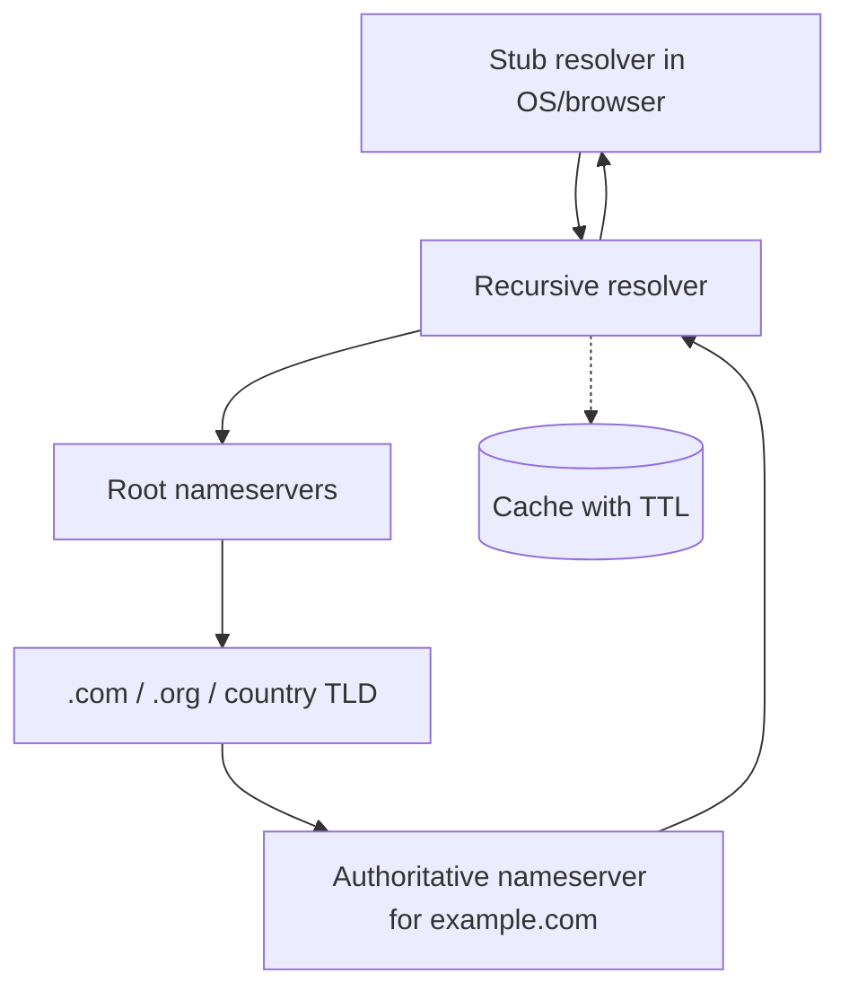

# DNS explained

> The Domain Name System is a distributed, hierarchical database that maps human-readable names to records such as IP addresses, mail servers, and verification tokens.

**Level:** beginner  
**Time:** 9 minutes  
**Scope:** recursive resolution for the web, common record types, caching, and DNSSEC. It does not cover zone-file syntax exhaustively or BGP.

## The mental model

A postal directory with no single master copy. Your browser asks a local helper (the recursive resolver). The helper asks the root, then the top-level domain, then the authoritative name server. The answer is cached with an expiry time.

The hierarchy is what makes DNS scale: no single server knows every name. Each zone owner is responsible for its own records.

Where the analogy breaks: DNS is not just a phone book. It is a general record system used for email routing, service discovery, domain ownership verification, and security policy.

## The hierarchy

1. **Stub resolver.** The browser or OS asks its configured recursive resolver.
2. **Recursive resolver.** Usually operated by an ISP, Cloudflare, Google, or your company. It does the legwork.
3. **Root servers.** Refer the resolver to the relevant TLD.
4. **TLD servers.** Refer to the domain's authoritative nameservers.
5. **Authoritative servers.** Return the actual records.

The recursive resolver caches each answer according to its **TTL**. The authoritative server is the source of truth for the zone.

## Common records

| Record | Meaning | Example use |
|---|---|---|
| `A` | IPv4 address | `example.com → 203.0.113.10` |
| `AAAA` | IPv6 address | `example.com → 2001:db8::10` |
| `CNAME` | Alias to another name | `www → example.com` |
| `MX` | Mail exchanger | `example.com → mail.example.com` |
| `TXT` | Arbitrary text | SPF, DKIM, domain verification |
| `NS` | Delegation to authoritative servers | `example.com → ns1.provider.net` |
| `SOA` | Zone authority and timing metadata | Serial, refresh, retry, expiry |
| `SRV` | Service location | `_sip._tcp.example.com` |
| `CAA` | Which CAs may issue certificates | Restrict certificate issuance |

## Caching and “propagation”

DNS changes are not broadcast. Resolvers cache answers until the TTL expires. “Propagation” is shorthand for “caches eventually expire or are flushed.”

If the old TTL was 24 hours, some resolvers may keep the old answer for up to 24 hours. Lower the TTL **before** a migration, not after. Some resolvers ignore very low TTLs or apply minimum TTL policies.

## DNSSEC

DNSSEC adds cryptographic signatures to DNS records. A validating resolver can verify that an answer came from the zone and was not modified in transit.

It does **not** encrypt queries, and it does not make a website trustworthy. It authenticates the DNS data. **DNS over HTTPS (DoH)** and **DNS over TLS (DoT)** encrypt the transport between the client and resolver; they solve a different problem.

| Technology | Protects | Does not protect |
|---|---|---|
| DNSSEC | Integrity and origin of records | Query privacy, server compromise |
| DoH / DoT | Client-to-resolver privacy | Authoritative server trust |
| HTTPS | Web content in transit | DNS lookups unless DoH is used |

## Failure modes

| Symptom | Cause | Fix |
|---|---|---|
| NXDOMAIN after adding a record | Wrong zone, typo, or unsaved change | Check the authoritative answer directly |
| Works for some users only | Resolver cache or split-horizon DNS | Check TTL and multiple resolvers |
| Mail goes to spam | Missing MX, SPF, DKIM, or DMARC | Publish and validate all three |
| CNAME at the apex fails | CNAME cannot coexist with other apex records | Use provider ALIAS/ANAME or flattening |
| DNSSEC outage | Expired signature or misconfigured DS | Monitor expiry and chain of trust |
| Certificate issue fails | CAA record blocks the CA | Update CAA deliberately |

## Check your understanding

1. Why does changing an A record not update every user immediately?
2. What is the difference between an authoritative answer and a cached answer?
3. A CNAME points `www` to a CDN hostname. Where does TLS termination likely happen, and why does that matter?

## Primary sources

- IETF, [RFC 1034](https://www.rfc-editor.org/rfc/rfc1034) and [RFC 1035](https://www.rfc-editor.org/rfc/rfc1035).
- IETF, [RFC 4033: DNSSEC introduction](https://www.rfc-editor.org/rfc/rfc4033).
- IETF, [RFC 8484: DNS over HTTPS](https://www.rfc-editor.org/rfc/rfc8484).
- Cloudflare, [What is DNS?](https://www.cloudflare.com/learning/dns/what-is-dns/).
- IANA, [DNS root servers](https://www.iana.org/domains/root/servers).

> **Next:** [HTTP and HTTPS](./http-vs-https.md) use DNS to find the server, then negotiate a secure request.

---

**Last reviewed: 2026-11-03.** Corrections welcome; open an issue with a primary source.
