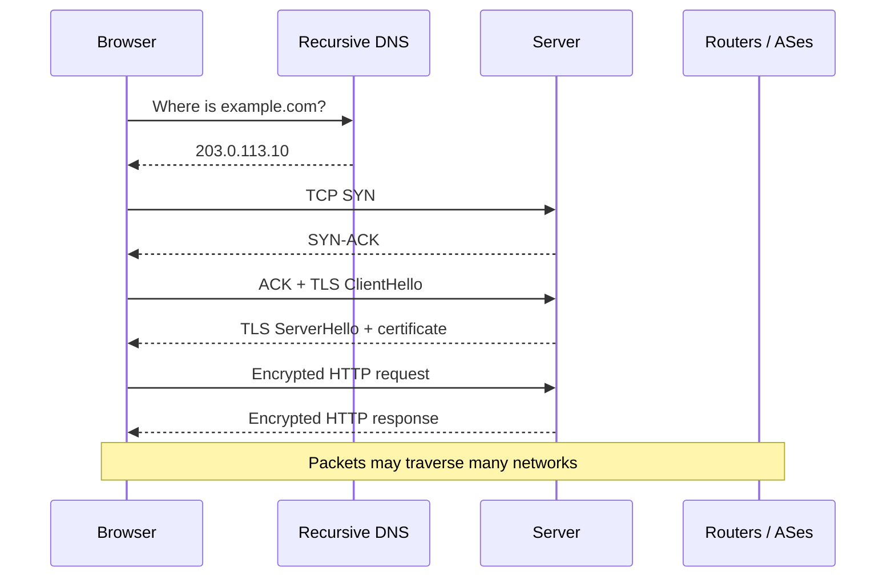

# How the internet works

> The internet is a network of networks that forwards small packets of data between devices using shared addressing and routing rules; the web is one application built on top of it.

**Level:** beginner  
**Time:** 11 minutes  
**Scope:** the path from a browser request to a server and back. It introduces DNS, TCP/TLS, and BGP but does not teach network engineering.

## The mental model

Imagine a global postal system where no single company owns every road. Your computer hands a parcel to its local network. Routers pass it toward a destination address, sometimes through several competing carriers. The parcel may be split into numbered letters; they can take different routes and be reassembled at the end.

The internet is the roads and sorting centres. The **web** is one kind of parcel: HTTP requests for pages, images, and APIs. Email, video calls, and multiplayer games use the same roads with different rules.

Where the analogy breaks: packets are not physical, routes change constantly, and “delivery” is a best-effort promise. Reliability is usually added by a protocol such as TCP, not by the network itself.

## The layers

| Layer | Job | Examples |
|---|---|---|
| Application | What the data means | HTTP, DNS, SMTP, WebSocket |
| Transport | Process-to-process delivery | TCP, UDP, QUIC |
| Internet | Addressing and routing across networks | IP, ICMP, BGP |
| Link | Local delivery on a physical medium | Ethernet, Wi-Fi, cellular |

Each layer wraps the one above it. An HTTP request becomes TCP segments, then IP packets, then frames on a wire or radio.

## The path of a request

### 1. Name resolution

Humans use names; routers use IP addresses. DNS translates `example.com` into one or more addresses. The answer is cached at several layers, which is why a change is not instantly visible everywhere.

### 2. Routing

Your device sends packets to a gateway. Routers consult forwarding tables to choose the next hop. At the global scale, **autonomous systems (ASes)** exchange reachability information using **BGP**. BGP is policy-driven, not a shortest-path algorithm in the naive sense; business relationships and traffic engineering shape routes.

### 3. Transport

TCP establishes a connection, numbers bytes, retransmits lost data, and adjusts its sending rate. UDP sends datagrams without those guarantees. QUIC combines reliability and encryption over UDP and is the transport for HTTP/3.

### 4. Application

TLS encrypts and authenticates the connection. HTTP carries the request method, path, headers, and body. The server responds with a status code and content.

## Why packets, not a stream

Circuit-switched networks reserve a path for the duration of a call. Packet switching shares links statistically: many conversations interleave packets, which is more efficient for bursty computer traffic.

The cost is variance. Packets can be lost, duplicated, reordered, or delayed. TCP hides most of this from the application; real-time applications often prefer to drop a late packet rather than wait for a retransmission.

## Failure modes

| Symptom | Likely layer | What to check |
|---|---|---|
| “Server not found” | DNS | Resolver, record, TTL, DNSSEC |
| Connection times out | Routing / firewall | IP reachability, security groups, MTU |
| TLS certificate error | TLS / DNS | Certificate chain, hostname, clock |
| Slow first byte | Server / routing | TTFB, origin latency, CDN |
| Works on Wi-Fi, fails on mobile | Path / MTU / IPv6 | MTU discovery, IPv6 reachability |
| Some regions cannot reach you | BGP / anycast | Looking glasses, route leaks, geo policy |

## What the internet does not guarantee

- Delivery. TCP can retry, but the network can still fail.
- A single path. Routes can change mid-connection.
- Low latency. Distance, congestion, and peering all matter.
- Identity. IP addresses are not authentication.
- Privacy. TLS protects content in transit, not the fact that a connection exists or the server's handling of the data.

## Check your understanding

1. Why can a website work on one network and fail on another without the server being down?
2. What does TCP add that IP does not provide?
3. DNS returns an IP address. Is that enough to make an HTTPS request? What else is needed?

## Primary sources

- Cloudflare, [How does the Internet work?](https://www.cloudflare.com/learning/network-layer/how-does-the-internet-work/).
- IETF, [RFC 791: Internet Protocol](https://www.rfc-editor.org/rfc/rfc791).
- IETF, [RFC 4271: BGP-4](https://www.rfc-editor.org/rfc/rfc4271).
- IETF, [RFC 9293: TCP](https://www.rfc-editor.org/rfc/rfc9293).
- Kurose and Ross, [Computer Networking: A Top-Down Approach](https://gaia.cs.umass.edu/kurose_ross/index.php).

> **Next:** [DNS explained](./dns-explained.md) zooms into the name system.

---

**Last reviewed: 2026-11-03.** Corrections welcome; open an issue with a primary source.
