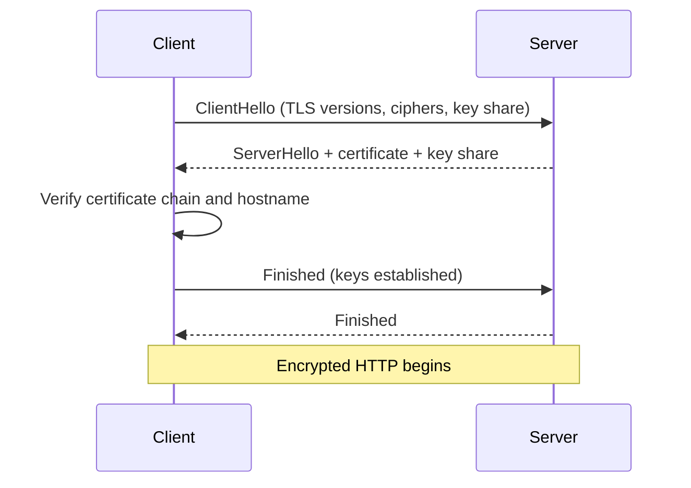

# HTTP and HTTPS

> HTTP is the request/response protocol of the web; HTTPS is HTTP carried over TLS, which encrypts and authenticates the connection between a client and a server.

**Level:** beginner  
**Time:** 12 minutes  
**Scope:** HTTP semantics, HTTP/1.1–3, and the TLS handshake at a practical level. It does not cover every header or certificate-authority policy.

## The mental model

HTTP is a structured conversation:

```text
GET /articles/dns HTTP/1.1
Host: example.com
Accept: text/html
```

The server answers:

```text
HTTP/1.1 200 OK
Content-Type: text/html; charset=utf-8
Cache-Control: max-age=600

<!doctype html>...
```

It is **stateless**: each request carries what it needs. Cookies and tokens add continuity. A load balancer, cache, or CDN may answer before the origin server.

HTTPS wraps that conversation in TLS. A passive observer can still see the destination IP and, depending on the protocol version, some metadata, but not the request body or response body.

Where the analogy breaks: HTTP is not just “GET a page.” It is a semantic protocol for resources, methods, caching, authentication, ranges, and conditional requests.

## Methods and status

| Method | Safe? | Idempotent? | Typical use |
|---|---:|---:|---|
| `GET` | Yes | Yes | Read a resource |
| `HEAD` | Yes | Yes | Read headers only |
| `POST` | No | No | Create or submit data |
| `PUT` | No | Yes | Replace a resource |
| `PATCH` | No | Not necessarily | Partial update |
| `DELETE` | No | Yes | Remove a resource |

**Safe** means no intended state change. **Idempotent** means repeating the request has the same intended effect as one request. These properties matter for retries, caches, and proxies.

Status classes: `2xx` success, `3xx` redirection, `4xx` client error, `5xx` server error. The specific code matters: `401` means authenticate, `403` means authenticated but forbidden, `409` is a conflict, `429` is rate limiting, `503` is temporary unavailability.

## HTTPS is two guarantees

1. **Confidentiality.** The content is encrypted in transit.
2. **Authentication.** The client verifies that the server controls the private key for the certificate.

It does **not** guarantee that the server is honest, that the application is secure, or that data is safe after it arrives. A phishing site can have a valid certificate.

### The TLS handshake, simplified



TLS 1.3 reduces the handshake to one round trip in the common case (and can resume with zero round trips). Certificates are issued by a certificate authority and chained to a trusted root.

**HSTS** tells browsers to use HTTPS for future requests. It is powerful: a misconfiguration can lock users out until the max-age expires.

## HTTP versions

| Version | Transport | Key idea | Trade-off |
|---|---|---|---|
| HTTP/1.1 | TCP | Text protocol; persistent connections | Head-of-line blocking at the connection level |
| HTTP/2 | TCP | Binary multiplexing over one connection | TCP-level head-of-line blocking remains |
| HTTP/3 | QUIC over UDP | Independent streams; faster handshake | Newer operational surface; UDP may be blocked |

In HTTP/1.1, browsers open multiple connections to work around head-of-line blocking. In HTTP/2, streams share a connection, but a lost TCP packet can still stall all streams. QUIC moves reliability into independent streams.

## Caching is part of the protocol

| Header | Meaning |
|---|---|
| `Cache-Control: max-age=600` | Fresh for 600 seconds |
| `Cache-Control: no-store` | Do not store |
| `ETag` | Opaque validator for the resource version |
| `If-None-Match` | Conditional request using an ETag |
| `Last-Modified` | Time-based validator |
| `Vary` | Cache key varies by header, e.g. `Accept-Encoding` |

A `304 Not Modified` avoids sending the body again. A CDN may cache a response even when your browser does not. Always test the actual cache layers.

## Security failure modes

| Risk | Example | Control |
|---|---|---|
| Mixed content | HTTPS page loads HTTP script | CSP, upgrade-insecure-requests, audit |
| Token leakage | Access token in a URL or logs | Short-lived tokens, secure cookies, redaction |
| CSRF | Cross-site form submits with cookies | SameSite cookies, CSRF tokens |
| XSS | Injected script reads tokens | Output encoding, CSP, HttpOnly cookies |
| Certificate expiry | Site breaks at midnight | Monitoring and automated renewal |
| HSTS lockout | Bad max-age on a broken HTTPS setup | Test on a subdomain first |

## Check your understanding

1. Why is `POST` not idempotent, and why does that matter for a retry?
2. TLS encrypts the request. What can a network observer still learn?
3. A CDN returns a stale page after a deploy. Which headers and cache layers would you inspect?

## Primary sources

- IETF, [RFC 9110: HTTP Semantics](https://www.rfc-editor.org/rfc/rfc9110).
- IETF, [RFC 9114: HTTP/3](https://www.rfc-editor.org/rfc/rfc9114).
- IETF, [RFC 8446: TLS 1.3](https://www.rfc-editor.org/rfc/rfc8446).
- MDN, [HTTP overview](https://developer.mozilla.org/en-US/docs/Web/HTTP/Overview).
- MDN, [Transport Layer Security](https://developer.mozilla.org/en-US/docs/Web/Security/Transport_Layer_Security).

> **Next:** [TCP vs UDP](./tcp-vs-udp.md) explains the transport underneath these versions.

---

**Last reviewed: 2026-11-03.** Corrections welcome; open an issue with a primary source.
