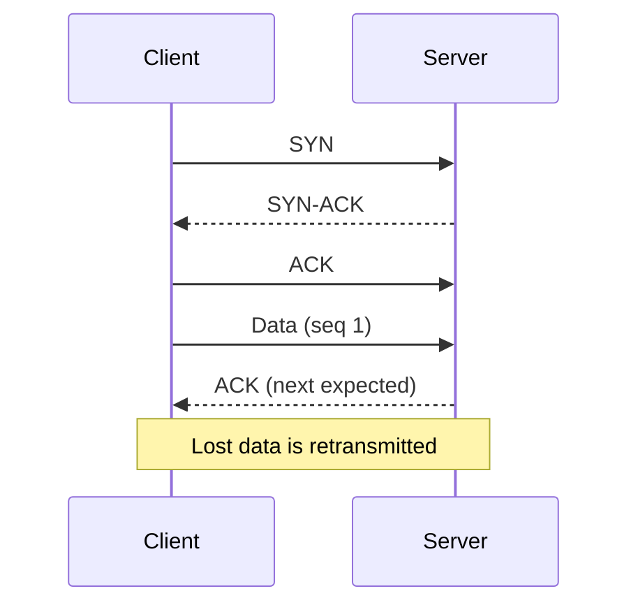

# TCP vs UDP

> TCP provides a reliable, ordered byte stream; UDP provides independent datagrams with no delivery or ordering guarantees. QUIC adds reliability and encryption on top of UDP for modern web traffic.

**Level:** beginner  
**Time:** 8 minutes  
**Scope:** the transport-layer trade-off and its practical consequences. It does not cover congestion-control algorithms in depth.

## The mental model

**TCP is a phone call.** You establish a connection, both sides track the conversation, and if a sentence is lost you repeat it. Order matters.

**UDP is postcards.** Each one is independent. Some may arrive late, out of order, or not at all. That is acceptable when a fresh update is more useful than an old one.

Where the analogy breaks: TCP is not a physical circuit, and UDP is not inherently unreliable at the application level. Applications can add their own acknowledgements, ordering, and retransmission — QUIC does exactly that.

## TCP

TCP provides:

- **Connection establishment** with a three-way handshake.
- **Reliability** through sequence numbers and retransmission.
- **Ordering** of bytes.
- **Flow control** so a fast sender does not overwhelm a slow receiver.
- **Congestion control** so the network is not overwhelmed.

The cost is latency: a lost packet can block later data until it is recovered (**head-of-line blocking**). That is fine for a file download and painful for a real-time game.

## UDP

UDP provides:

- A source and destination port.
- A length and checksum.
- No handshake, ordering, retransmission, or congestion control by default.

That sounds primitive, but it is a good foundation when the application knows better:

- **DNS** uses UDP for small, fast queries and falls back to TCP for large responses or zone transfers.
- **Video/voice** prefer a late frame dropped over a stalled stream.
- **Games** send frequent state updates where the newest position matters.
- **QUIC** builds reliable streams, TLS, and congestion control over UDP.

## The comparison

| Property | TCP | UDP |
|---|---|---|
| Connection | Yes | No |
| Reliable delivery | Yes | No |
| Ordered bytes | Yes | No |
| Congestion control | Built in | Application's job |
| Head-of-line blocking | Yes, at transport level | No inherent stream ordering |
| Typical use | HTTP/1.1, HTTP/2, SSH, databases | DNS, VoIP, games, QUIC/HTTP/3 |
| Latency profile | Higher setup and recovery cost | Lower overhead, variable loss |

## QUIC is the important plot twist

QUIC runs over UDP but gives you:

- encrypted transport by default,
- independent streams without TCP head-of-line blocking,
- a faster handshake,
- connection migration when a device changes networks.

HTTP/3 is HTTP over QUIC. The “UDP is unreliable” framing is still true at the datagram layer; QUIC adds the reliability where it belongs.

## Failure modes

| Symptom | Likely cause | What to check |
|---|---|---|
| Web request hangs on packet loss | TCP retransmission / head-of-line blocking | Packet capture, RTT, loss rate |
| Voice call turns robotic | Jitter or loss with no useful retransmission | Jitter buffer, codec, network quality |
| UDP blocked on a corporate network | Firewall policy | TCP/TLS fallback, HTTP/3 negotiation |
| Throughput collapses | Congestion control or bufferbloat | Queueing, BBR/CUBIC, link saturation |
| DNS intermittently fails | Large response over UDP or packet loss | EDNS buffer size, TCP fallback |

## Check your understanding

1. Why is TCP a poor default for a fast-paced multiplayer game?
2. What does QUIC add that raw UDP does not provide?
3. A file download is fast but a video call stutters on the same network. How can both be true?

## Primary sources

- IETF, [RFC 9293: TCP](https://www.rfc-editor.org/rfc/rfc9293).
- IETF, [RFC 768: UDP](https://www.rfc-editor.org/rfc/rfc768).
- IETF, [RFC 9000: QUIC](https://www.rfc-editor.org/rfc/rfc9000).
- Cloudflare, [What is TCP?](https://www.cloudflare.com/learning/ddos/glossary/tcp-ip/).
- MDN, [HTTP/3](https://developer.mozilla.org/en-US/docs/Web/HTTP/Guides/Evolution_of_HTTP).

> **Next:** [CDNs explained](./cdn-explained.md) put content closer to the user.

---

**Last reviewed: 2026-11-03.** Corrections welcome; open an issue with a primary source.
