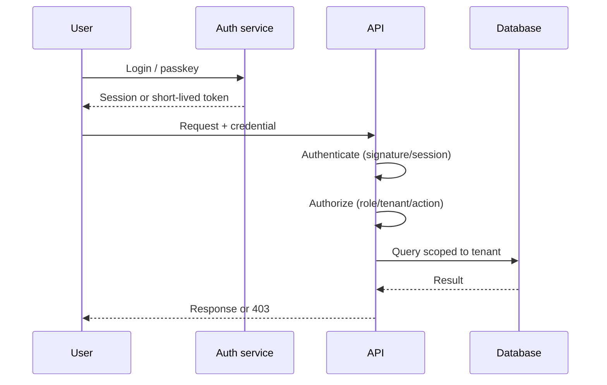

# Authentication vs authorization

> Authentication proves who a principal is; authorization decides what that principal may do. Confusing the two is one of the most common security bugs.

**Level:** beginner  
**Time:** 9 minutes  
**Scope:** web authentication, sessions, tokens, and authorization models. It does not cover every OAuth grant or identity-provider integration.

## The mental model

A hotel:

- **Authentication:** the front desk checks your ID and gives you a key.
- **Authorization:** the key opens your room, not the penthouse or the server room.

A valid key does not mean every door is yours. A valid login does not mean every API endpoint is allowed.

Where the analogy breaks: digital authorization happens on every request, often across services, and the “key” may be a short-lived token with embedded claims.

## Authentication

Authentication answers: **who are you?**

Common factors:

- Something you know: password, PIN.
- Something you have: passkey, TOTP, hardware key.
- Something you are: biometrics.

### Sessions vs tokens

| Approach | How it works | Strength | Risk |
|---|---|---|---|
| Server session | Random session ID in an HttpOnly cookie; server stores state | Easy revocation, opaque to client | Session store scaling |
| JWT access token | Signed claims sent with requests | Stateless verification across services | Revocation is hard; long-lived tokens are dangerous |
| Opaque token | Random token looked up server-side | Revocable and simple | Requires a lookup |
| Passkeys / WebAuthn | Public-key credential bound to origin | Phishing-resistant | Recovery and platform support |

For browser apps, **HttpOnly, Secure, SameSite cookies** are a strong default. Do not put long-lived secrets in `localStorage`.

### OAuth and OIDC

- **OAuth 2.0** delegates authorization: “this app may read your calendar.”
- **OpenID Connect (OIDC)** adds authentication on top of OAuth: “this user is Ada.”

OAuth is not a login protocol by itself. Use OIDC for identity, validate the ID token, and never trust an access token's claims without verifying signature, issuer, audience, and expiry.

## Authorization

Authorization answers: **what may this principal do?**

| Model | Question it answers | Example |
|---|---|---|
| RBAC | Does this role have permission? | `admin`, `editor`, `viewer` |
| ABAC | Do attributes satisfy the policy? | Region, clearance, time |
| ReBAC | Is there a relationship path? | “Owner of the document” |
| Policy-as-code | Does the policy engine allow it? | OPA/Rego, Cedar |

### Multi-tenant rule

Every tenant-scoped query needs a tenant predicate enforced **server-side**, preferably close to the data layer. Never trust a `tenant_id` from the request body. Prefer deriving it from the authenticated session and enforcing row-level security or a repository layer that cannot be bypassed.

```text
BAD:  SELECT * FROM invoices WHERE id = $1
GOOD: SELECT * FROM invoices WHERE id = $1 AND tenant_id = $2
```

## A request path



Authentication failure is `401`. Authorization failure is `403`. Do not leak whether a resource exists to an unauthorized user.

## Failure modes

| Failure | Example | Control |
|---|---|---|
| IDOR | Change `/invoice/123` to `/invoice/124` | Object-level authorization checks |
| Tenant leak | Missing `tenant_id` predicate | RLS / repository enforcement + tests |
| JWT confusion | Accepting `alg: none` or wrong issuer | Pin algorithms, verify iss/aud/exp |
| Token in URL | Access token in query string or logs | Cookies or Authorization header |
| Overbroad role | Every admin can read all tenants | Least privilege, scoped roles |
| Session fixation | Attacker sets a known session ID | Rotate on login, HttpOnly cookies |
| Missing logout | Token remains valid forever | Short expiry, revocation list |
| Enumeration | Different errors for existing users | Uniform responses and rate limits |

## Check your understanding

1. Why is “the user is logged in” not enough to authorize an invoice download?
2. What does OIDC add that OAuth 2.0 does not provide?
3. Why is a long-lived JWT harder to revoke than a server session?

## Primary sources

- NIST, [SP 800-63B: Digital Identity Guidelines](https://pages.nist.gov/800-63-3/sp800-63b.html).
- IETF, [RFC 6749: OAuth 2.0](https://www.rfc-editor.org/rfc/rfc6749).
- OpenID Foundation, [OpenID Connect Core](https://openid.net/specs/openid-connect-core-1_0.html).
- OWASP, [ASVS](https://owasp.org/www-project-application-security-verification-standard/).
- OWASP, [Authorization Cheat Sheet](https://cheatsheetseries.owasp.org/cheatsheets/Authorization_Cheat_Sheet.html).

> **Next:** [Encryption](./encryption.md) protects the data even when the network or disk is compromised.

---

**Last reviewed: 2026-11-03.** Corrections welcome; open an issue with a primary source.
