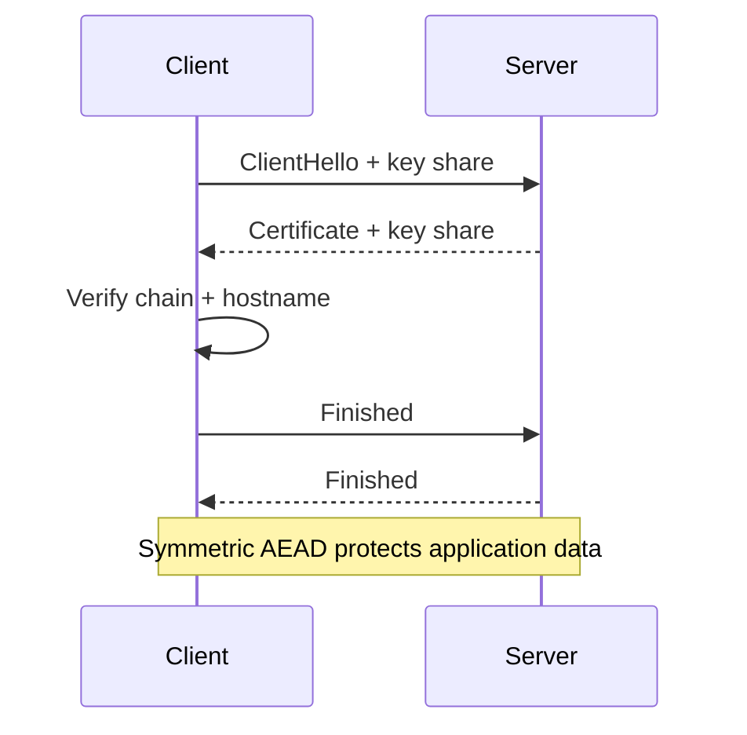

# Encryption

> Encryption transforms readable data into ciphertext using a key; only someone with the right key can reverse it. Hashing is different: it is one-way.

**Level:** beginner → intermediate  
**Time:** 11 minutes  
**Scope:** symmetric and asymmetric encryption, hashing, signatures, TLS, and storage. It is not a guide to inventing cryptographic protocols.

## The mental model

A locked box:

- **Symmetric encryption** is one key that both locks and unlocks. Fast, but you must share the key safely.
- **Asymmetric encryption** has a public lock and a private key. Anyone can lock; only the key holder can open.
- **Hashing** is a fingerprint. You cannot reconstruct the document from it, but you can check whether two documents are identical.

Where the analogy breaks: real cryptography operates on numbers, has precise security definitions, and fails catastrophically when composed incorrectly. **Do not invent your own protocol.** Use vetted libraries and standards.

## Symmetric encryption

One shared secret key. Modern default: **AES-GCM** or **ChaCha20-Poly1305**, both authenticated encryption with associated data (AEAD).

AEAD gives confidentiality and integrity: tampering is detected. A random nonce/IV must be unique per key; reusing a nonce with the same key can destroy confidentiality.

```text
ciphertext, tag = AEAD_encrypt(key, nonce, plaintext, associated_data)
plaintext       = AEAD_decrypt(key, nonce, ciphertext, tag, associated_data)
```

**Never use ECB mode.** It reveals patterns. Avoid unauthenticated modes unless you have a very specific reason and a MAC.

## Asymmetric encryption and signatures

A key pair:

- **Public key:** share it.
- **Private key:** protect it.

Asymmetric cryptography is slower than symmetric. It is used to establish a shared symmetric key (TLS), sign data, and verify identity.

**Signatures** prove authenticity and integrity, not confidentiality:

```text
signature = sign(private_key, message)
verify(public_key, message, signature) -> valid / invalid
```

RSA is still common, but elliptic curves (Ed25519, ECDSA) are smaller and faster for many uses. Choose based on protocol and library support, not vibes.

## Hashing

A cryptographic hash maps arbitrary input to a fixed-size digest. Properties:

- deterministic,
- fast to compute,
- infeasible to invert,
- collision-resistant,
- avalanche effect (small input change → very different output).

Use **SHA-256/SHA-3** for integrity and fingerprints. Use **Argon2id**, **scrypt**, or **bcrypt** for passwords — never a plain fast hash. Add a unique salt per password.

| Purpose | Algorithm | Note |
|---|---|---|
| Password storage | Argon2id / scrypt / bcrypt | Slow, salted, tuned |
| Data integrity | SHA-256 / SHA-3 | Not a password hash |
| Message authentication | HMAC-SHA-256 | Requires a secret key |
| Digital signature | Ed25519 / ECDSA / RSA-PSS | Verify the signer |
| Key derivation | HKDF / PBKDF2 | Context-specific |

## Encryption in transit

TLS combines asymmetric key exchange, certificates, and symmetric AEAD. It provides confidentiality, integrity, and server authentication.



TLS does not protect data at rest, and it does not stop a compromised server from reading plaintext. It protects the channel.

## Encryption at rest

Options:

- **Full-disk encryption:** protects against stolen disks, not a running compromised host.
- **Database encryption:** often transparent; key management is the hard part.
- **Application-level encryption:** encrypt specific fields before storage; useful for secrets and tenant isolation, but queries become harder.
- **Envelope encryption:** encrypt data with a data key; encrypt the data key with a KMS master key.

Key management is the real system: generation, rotation, access control, audit, backup, and destruction. A key stored next to the ciphertext is not protection.

## Failure modes

| Failure | Consequence | Fix |
|---|---|---|
| Nonce reuse | Catastrophic confidentiality loss | Unique nonce per encryption |
| ECB mode | Pattern leakage | Use AEAD |
| Hard-coded key | Full compromise | KMS / secret manager, rotation |
| Plain hash for passwords | Fast offline cracking | Argon2id with per-user salt |
| Hash collision assumptions | Integrity failure | Use modern collision-resistant hashes |
| Missing certificate validation | Man-in-the-middle | Verify chain and hostname |
| Custom crypto | Unknown weaknesses | Use vetted libraries and protocols |
| No key rotation | Long-lived blast radius | Versioned keys and rotation plan |

## Check your understanding

1. Why is hashing not encryption?
2. What does AES-GCM provide that AES-CBC does not?
3. You encrypt a database field but need to search by it. What are the trade-offs of deterministic encryption or a searchable index?

## Primary sources

- NIST, [SP 800-57: Key Management](https://csrc.nist.gov/pubs/sp/800/57/pt1/r5/final).
- NIST, [SP 800-38D: GCM](https://csrc.nist.gov/pubs/sp/800/38/d/final).
- IETF, [RFC 8446: TLS 1.3](https://www.rfc-editor.org/rfc/rfc8446).
- OWASP, [Password Storage Cheat Sheet](https://cheatsheetseries.owasp.org/cheatsheets/Password_Storage_Cheat_Sheet.html).
- MDN, [Web Crypto API](https://developer.mozilla.org/en-US/docs/Web/API/Web_Crypto_API).

> **Next:** [Containers vs virtual machines](../cloud-devops/containers-vs-vms.md) moves from data protection to isolation.

---

**Last reviewed: 2026-11-03.** Corrections welcome; open an issue with a primary source.
