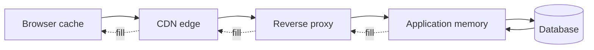

# Caching

> A cache stores a copy of data closer to the consumer so future requests are faster or cheaper; the hard part is deciding when the copy is allowed to be wrong.

**Level:** beginner → intermediate  
**Time:** 11 minutes  
**Scope:** application, HTTP, and CDN caching concepts. It does not cover CPU cache architecture.

## The mental model

A desk drawer holds the documents you use every day. The archive has everything, but walking there is slow. You copy a document to the drawer, use it, and replace it when it changes.

The drawer can be stale. If someone edits the archive and does not tell you, you keep using the old copy. That is the central trade-off: **freshness versus speed**.

Where the analogy breaks: caches are layered and automated. Your browser, CDN, reverse proxy, application memory, and database may each hold a different version.

## The layers

| Layer | Typical TTL | Invalidation | Best for |
|---|---|---|---|
| Browser | Minutes–years | User clear, versioned URLs | Static assets |
| CDN | Minutes–days | Purge/tag/version | Public content |
| Reverse proxy | Seconds–minutes | Purge/key | API and page fragments |
| Application | Seconds–hours | TTL/event | Expensive computations |
| Database | Managed | Engine-specific | Query plans, buffers |

## Cache patterns

### Cache-aside (lazy loading)

Read from cache; on miss, read the source, write to cache, return. Simple and common. The first request is slow, and a stampede is possible when a hot key expires.

### Write-through

Write to cache and source in the same path. Fresher data, but writes are slower and the cache becomes a critical dependency.

### Write-behind

Write to cache and asynchronously persist. Fast, but a crash can lose data. Use only when the data is reconstructible or the loss is acceptable.

### Read-through

The cache library fetches from the source on a miss. Convenient, but hides latency and failure behaviour.

## Invalidation strategies

| Strategy | How | Trade-off |
|---|---|---|
| TTL | Expire after time | Simple; bounded staleness |
| Explicit delete | Remove key on write | Race conditions between write and fill |
| Versioned keys | Include a version in the key | Old keys linger until eviction |
| Write-through | Update both | Consistency, but more coupling |
| Event-driven | Invalidate on domain event | Reliable only if events are reliable |

**The classic race:** reader misses, fetches old value; writer updates source and deletes key; reader writes old value back into cache. Mitigations include versioned keys, “delete after write” with a delay, or a short lock.

## Eviction

A cache is finite. Common policies:

- **LRU:** least recently used. Good general default.
- **LFU:** least frequently used. Better for stable hot sets, slower to adapt.
- **FIFO:** simple, often poor.
- **TTL:** expiry independent of access.

Eviction is not invalidation. An evicted item is simply gone; a stale item is still wrong until it expires.

## Stampede and hot keys

When a popular key expires, many requests miss simultaneously and hit the database. Protections:

- Request coalescing / single-flight.
- Probabilistic early expiration.
- Stale-while-revalidate.
- A short distributed lock.
- Pre-warming after deploy.

A hot key can also overload one cache shard. Replicate the key or add a local in-process cache.

## Failure modes

| Failure | Symptom | Mitigation |
|---|---|---|
| Stale data | Users see old prices or permissions | Short TTL, explicit invalidation, versioning |
| Cache stampede | Database spikes on expiry | Single-flight, jitter, stale-while-revalidate |
| Cache penetration | Requests for nonexistent keys hit DB | Negative caching |
| Hot key | One shard saturated | Key replication, local cache |
| Thundering herd after deploy | Cold caches overwhelm origin | Warm caches, gradual rollout |
| Security leak | Cached private response served to another user | `private`/`no-store`, correct `Vary` |
| Invalidation race | Old value resurrected | Versioned keys, write-through |

## What not to cache

- Authorization decisions unless the invalidation is airtight.
- One-time tokens and CSRF secrets.
- Rapidly changing balances without a consistency plan.
- Huge objects that evict the working set.
- Data you cannot delete for privacy compliance.

## Check your understanding

1. Why is “just set a 5-minute TTL” not a complete invalidation strategy?
2. What is the difference between cache eviction and cache invalidation?
3. A cache reduces p50 latency but increases p99. What could cause that?

## Primary sources

- MDN, [HTTP caching](https://developer.mozilla.org/en-US/docs/Web/HTTP/Guides/Caching).
- AWS, [Caching best practices](https://aws.amazon.com/caching/best-practices/).
- Redis, [Caching patterns](https://redis.io/docs/latest/develop/use/patterns/).
- Cloudflare, [What is caching?](https://www.cloudflare.com/learning/cdn/what-is-caching/).
- Kleppmann, [Designing Data-Intensive Applications](https://dataintensive.net/).

> **Next:** [Message queues](./message-queues.md) move work out of the request path.

---

**Last reviewed: 2026-11-03.** Corrections welcome; open an issue with a primary source.
