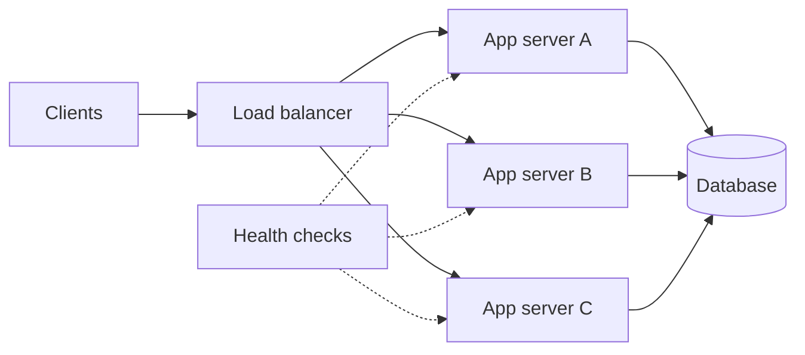

# Load balancing

> A load balancer distributes traffic across multiple servers so no single machine is a bottleneck or a single point of failure.

**Level:** beginner  
**Time:** 9 minutes  
**Scope:** layer 4 vs layer 7 balancing, algorithms, health checks, and common failure modes. It does not compare cloud provider products.

## The mental model

A supermarket opens several checkout lanes. A queue coordinator sends each customer to a free lane. If a lane closes, the coordinator stops sending people there. If the coordinator itself fails, the whole checkout stops.

A load balancer is the coordinator. The servers are lanes. The health check is how the coordinator knows a lane is open.

Where the analogy breaks: requests are not identical customers. Some are long-lived connections, some are stateful sessions, and some are much more expensive than others.

## Layer 4 vs layer 7

| Layer | Sees | Can do | Cannot easily do |
|---|---|---|---|
| L4 (TCP/UDP) | IPs, ports, connection metadata | Fast forwarding, connection draining | Route by URL, header, or cookie |
| L7 (HTTP) | Method, path, headers, cookies | Path routing, TLS termination, retries, rate limits | See inside encrypted payload unless terminating TLS |

L4 is simpler and faster. L7 is more flexible and is usually where application-aware routing lives.

## Algorithms

| Algorithm | How it chooses | Best for | Weakness |
|---|---|---|---|
| Round robin | Next server in order | Similar, stateless requests | Ignores load |
| Weighted round robin | Proportional to capacity | Heterogeneous servers | Static weights |
| Least connections | Fewest active connections | Long-lived or uneven requests | Connection count ≠ cost |
| Least response time | Fastest recent latency | Latency-sensitive APIs | Can oscillate |
| Consistent hashing | Hash key to a ring | Cache affinity, sharding | Rebalancing complexity |
| Random | Pick at random | Simple, large pools | Uneven short-term distribution |
| IP hash | Hash client IP | Session affinity | NAT and mobile changes break it |

**Sticky sessions** are a compromise, not a strategy. Prefer stateless services with shared session storage or signed tokens. If you need affinity, use consistent hashing and plan for rebalancing.

## Health checks

- **Liveness:** is the process alive?
- **Readiness:** can it accept traffic?
- **Deep health:** can it reach its dependencies?

A deep health check that fails on a transient database blip can remove every server at once. Separate “process alive” from “dependency degraded,” and use graceful degradation.

## Failure modes

| Failure | Symptom | Mitigation |
|---|---|---|
| Health check too aggressive | Flapping, mass removal | Thresholds, grace periods, shallow checks |
| Health check too shallow | Traffic sent to a broken app | Readiness + synthetic checks |
| Sticky session loss | Users logged out or lose carts | Shared sessions, stateless tokens |
| Uneven load | One server hot, others idle | Least-connections, better metrics |
| Retry storm | Load balancer retries amplify failure | Retry budgets, jitter, circuit breakers |
| Connection exhaustion | New requests queue | Pooling, timeouts, autoscaling |
| TLS mismatch | Handshake errors | Certificate chain and SNI review |

## Load balancing is not autoscaling

A load balancer spreads traffic across the capacity you have. Autoscaling adds or removes capacity. Without health checks, metrics, and a warm-up strategy, autoscaling can add instances that are not ready to serve.

## Check your understanding

1. Why can least-connections be worse than round robin for very short requests?
2. What is the difference between a liveness and a readiness check?
3. Why is sticky sessions a scalability compromise?

## Primary sources

- NGINX, [Load balancing](https://docs.nginx.com/nginx/admin-guide/load-balancer/http-load-balancer/).
- Envoy, [Load balancing](https://www.envoyproxy.io/docs/envoy/latest/intro/arch_overview/upstream/load_balancing/load_balancing).
- Cloudflare, [What is load balancing?](https://www.cloudflare.com/learning/performance/what-is-load-balancing/).
- AWS, [Elastic Load Balancing documentation](https://docs.aws.amazon.com/elasticloadbalancing/).
- Google, [Site Reliability Engineering](https://sre.google/sre-book/table-of-contents/).

> **Next:** [Caching](./caching.md) explains how to avoid doing the same work twice.

---

**Last reviewed: 2026-11-03.** Corrections welcome; open an issue with a primary source.
