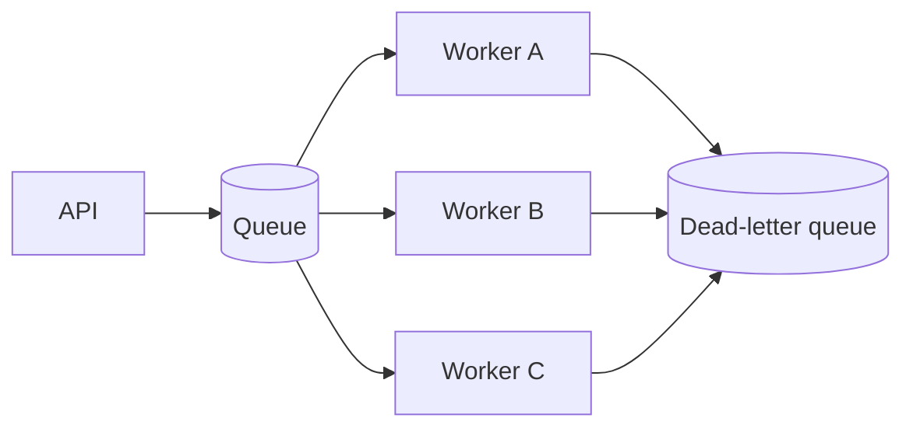

# Message queues

> A message queue decouples a producer from a consumer, letting work happen asynchronously and absorb spikes; the price is eventual consistency, duplicate delivery, and operational complexity.

**Level:** intermediate  
**Time:** 10 minutes  
**Scope:** queue and log-based messaging, delivery semantics, idempotency, and retries. It does not compare every broker.

## The mental model

A restaurant ticket rail. The waiter places an order; the kitchen works through tickets at its own pace. If the kitchen is busy, the rail holds the backlog. If a ticket is lost, the customer waits forever unless someone notices.

A queue is the rail. The producer is the waiter; the consumer is the kitchen. The queue absorbs bursts and lets each side fail independently.

Where the analogy breaks: messages can be duplicated, reordered, delayed, or delivered after a consumer crashes. The system must be designed for those realities.

## Queue vs log

| Model | Behaviour | Example | Best for |
|---|---|---|---|
| Queue | Each message delivered to one consumer, then removed | SQS, RabbitMQ | Task distribution |
| Log | Append-only sequence; consumers track offsets | Kafka, Kinesis | Event streams, replay, multiple consumers |
| Pub/sub | Fan-out to many subscribers | SNS, Google Pub/Sub | Notifications, event broadcast |

A queue is a work queue. A log is a replayable history. They solve different problems.



## Delivery semantics

- **At-most-once:** may lose a message, never duplicates. Rarely acceptable for money or critical work.
- **At-least-once:** may duplicate, never silently loses. The practical default.
- **Exactly-once:** a narrow guarantee, usually within one system and often implemented with idempotency plus transactions. Do not assume it across services.

**At-least-once means your consumer must be idempotent.** A duplicate delivery should not double-charge a card or send two emails.

## Idempotency

Use a stable idempotency key:

```text
operation_id = hash(job_type, business_key, version)
```

Store the result keyed by `operation_id`. On a duplicate, return the stored result instead of repeating the side effect. A unique constraint in the database is often the simplest enforcement.

## Retries and dead-letter queues

Retries handle transient failures. They also amplify load. Use:

- exponential backoff with jitter,
- a maximum attempt count,
- a dead-letter queue for poison messages,
- a visibility timeout longer than the expected processing time,
- alerting on DLQ depth.

A poison message that crashes every consumer should not loop forever.

## Ordering

Global ordering is expensive. Most systems offer per-key ordering. If you need order per customer, partition by `customer_id` and accept that different customers may be processed concurrently.

Ordering plus retries can still reorder work: message A fails and retries while B succeeds. Use sequence numbers or a state machine to reject out-of-order updates.

## The outbox pattern

The dual-write problem: the database commit succeeds, but publishing the event fails. Or the event publishes, but the database rolls back.

```text
BEGIN
  INSERT order
  INSERT outbox_event
COMMIT
Relay reads outbox and publishes
Mark event published
```

The relay may publish twice; consumers must be idempotent. This is usually better than a distributed transaction.

## Backpressure

An unbounded queue is a memory leak with extra steps. If producers outrun consumers forever, latency grows and the queue becomes a database you did not design.

Use:

- bounded queues,
- consumer concurrency limits,
- rate limits at the producer,
- load shedding when depth exceeds a threshold,
- autoscaling based on queue depth and age, not just CPU.

## Failure modes

| Failure | Symptom | Mitigation |
|---|---|---|
| Duplicate processing | Double email or charge | Idempotency key + unique constraint |
| Poison message | Consumer crash loop | DLQ, max attempts, validation |
| Queue backlog | Rising latency and memory | Scale consumers, shed load, alert on age |
| Lost event | Missing downstream state | Outbox, acknowledgements, reconciliation |
| Reordering | Old state overwrites new | Per-key ordering, version checks |
| Visibility timeout too short | Same job processed twice | Tune timeout, extend lease |
| Consumer crash after side effect | Duplicate side effect | Transactional outbox / idempotency |

## Check your understanding

1. Why is “exactly-once delivery” usually a property of the whole processing pipeline, not just the broker?
2. What is the difference between a retry and a dead-letter queue?
3. A queue depth is stable but p99 latency is rising. What else should you measure?

## Primary sources

- AWS, [Amazon SQS documentation](https://docs.aws.amazon.com/sqs/).
- Apache Kafka, [Documentation](https://kafka.apache.org/documentation/).
- RabbitMQ, [Reliability guide](https://www.rabbitmq.com/docs/reliability).
- Google Cloud, [Pub/Sub documentation](https://cloud.google.com/pubsub/docs/).
- Kleppmann, [Designing Data-Intensive Applications](https://dataintensive.net/).

> **Next:** [Rate limiting](./rate-limiting.md) protects the system when the queue is not enough.

---

**Last reviewed: 2026-11-03.** Corrections welcome; open an issue with a primary source.
