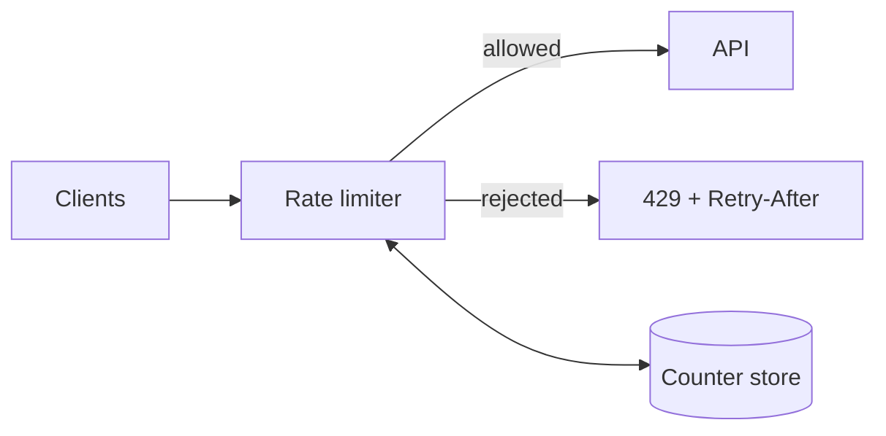

# Rate limiting

> Rate limiting controls how many requests a client may make in a period, protecting capacity, enforcing fair use, and containing abuse.

**Level:** beginner → intermediate  
**Time:** 10 minutes  
**Scope:** common algorithms, distributed enforcement, and product trade-offs. It does not cover full bot management or billing.

## The mental model

A bouncer with a clicker counts how many people enter per minute. When the count is full, the door closes until the next window. A good bouncer distinguishes a VIP, a returning visitor, and someone trying to rush the door.

Rate limiting is the clicker. It is not authentication and not a WAF. It is a capacity and fairness control.

Where the analogy breaks: requests have different costs. One expensive AI call is not equivalent to ten static file reads. A single global request count can be the wrong unit.

## Algorithms

### Fixed window

Count requests in a fixed interval. Simple, but a client can send 2× the limit across a boundary (the “burst at the edge” problem).

```text
window = floor(now / 60)
count[client][window] += 1
allow if count <= limit
```

### Sliding window log

Store timestamps and count those within the last interval. Accurate, but memory grows with request volume.

### Sliding window counter

Combine the current and previous fixed windows with a weighted estimate. A good balance of accuracy and memory.

### Token bucket

A bucket refills at a steady rate; each request consumes a token. Allows bursts up to the bucket size, then enforces the average rate.

```text
tokens = min(capacity, tokens + elapsed * refill_rate)
if tokens >= cost: tokens -= cost; allow
else: reject
```

### Leaky bucket

Requests enter a queue and drain at a fixed rate. Smooths traffic, but adds latency and queue depth.



## What to count

| Key | Use | Abuse risk |
|---|---|---|
| IP address | Anonymous traffic | NAT and shared networks punish innocent users |
| User ID | Authenticated fairness | Account creation farms |
| API key | Partner quotas | Key sharing |
| Tenant/workspace | SaaS plan limits | Noisy neighbours |
| Route + method | Protect expensive endpoints | Ignores total load |
| Cost units | AI tokens, bytes, jobs | More complex to meter |

**Cost-based limiting** is often better than request counting. Charge one unit for a cheap read and fifty for a video transcode. The limit then reflects actual resource consumption.

## HTTP behaviour

Return **429 Too Many Requests** with useful headers:

```http
HTTP/1.1 429 Too Many Requests
Retry-After: 30
RateLimit-Limit: 100
RateLimit-Remaining: 0
RateLimit-Reset: 30
```

Do not silently drop requests. Clients need to back off. Add jitter to retries; synchronized retries create a new spike.

## Distributed enforcement

A per-instance in-memory counter is not a global limit. Options:

- **Central store:** Redis or a database atomic counter. Adds a network hop and a dependency.
- **Sticky routing:** send a client to one instance. Fragile under scaling.
- **Approximate limits:** local buckets with periodic reconciliation. Simpler, less exact.
- **Edge enforcement:** stop traffic before it reaches the origin. Good for coarse limits.

A distributed limiter needs atomic increment-and-expire. A read-then-write sequence can allow a burst.

## Fairness and product design

- **Free tier:** lower limit, clear upgrade path.
- **Paid tier:** higher limit and burst allowance.
- **Burst vs sustained:** token bucket for short spikes; sustained rate for abuse.
- **Grace:** don’t hard-fail a user who crosses the limit once.
- **Observability:** log key, route, decision, and remaining budget; avoid logging secrets.

## Failure modes

| Failure | Symptom | Mitigation |
|---|---|---|
| Limiter store down | All requests rejected or all allowed | Fail-open for low-risk routes, fail-closed for sensitive ones |
| Shared IP punished | Office or mobile users blocked | Combine IP with account key |
| Boundary burst | 2× limit at window edge | Sliding window or token bucket |
| Thundering herd after 429 | Retry storm | `Retry-After` + jitter + client backoff |
| Counter not atomic | Limit exceeded under concurrency | Atomic Lua script / transaction |
| Unbounded keys | Memory growth | TTL, shard, cap key cardinality |
| Wrong unit | Cheap routes starve expensive ones | Cost-based quotas |

## Check your understanding

1. Why can a fixed-window limiter allow twice the intended rate at a boundary?
2. When would IP-based limiting be unfair, and what would you combine it with?
3. What does a token bucket allow that a leaky bucket does not?

## Primary sources

- Cloudflare, [Rate limiting best practices](https://developers.cloudflare.com/waf/rate-limiting-rules/best-practices/).
- Envoy, [Rate limit overview](https://www.envoyproxy.io/docs/envoy/latest/intro/arch_overview/other_features/global_rate_limiting).
- IETF, [RFC 6585: 429 Too Many Requests](https://www.rfc-editor.org/rfc/rfc6585).
- Stripe, [Rate limits](https://docs.stripe.com/rate-limits).
- Google, [Site Reliability Engineering: Handling Overload](https://sre.google/sre-book/handling-overload/).

> **Next:** [Authentication vs authorization](../security/authentication-vs-authorization.md) protects who can call the API at all.

---

**Last reviewed: 2026-11-03.** Corrections welcome; open an issue with a primary source.
